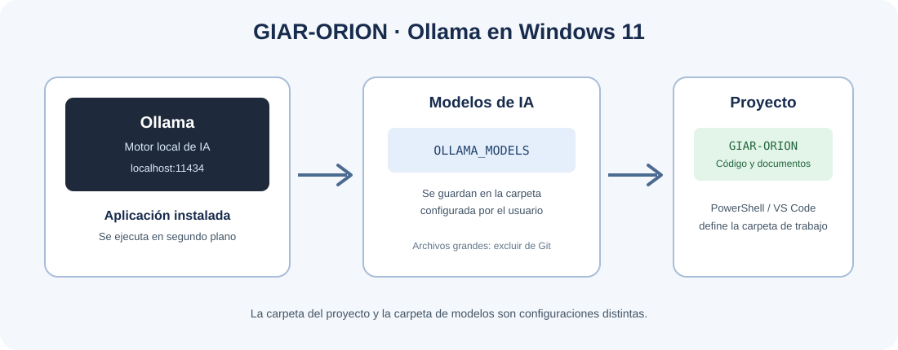

# GIAR-ORION — Manual de instalación y configuración de Ollama en Windows 11

## Índice

1. [Objetivo](#1-objetivo)
2. [Requisitos previos](#2-requisitos-previos)
3. [Descargar e instalar Ollama](#3-descargar-e-instalar-ollama)
4. [Comprobar la instalación](#4-comprobar-la-instalación)
5. [Configurar la carpeta de modelos](#5-configurar-la-carpeta-de-modelos)
6. [Abrir GIAR-ORION como directorio de trabajo](#6-abrir-giar-orion-como-directorio-de-trabajo)
7. [Probar Ollama](#7-probar-ollama)
8. [Verificar el servicio local](#8-verificar-el-servicio-local)
9. [Uso sin Internet](#9-uso-sin-internet)
10. [Problemas frecuentes](#10-problemas-frecuentes)
11. [Referencias oficiales](#11-referencias-oficiales)

---

## 1. Objetivo

Este manual explica cómo instalar Ollama en Windows 11 y prepararlo para el proyecto **GIAR-ORION**, cuyo directorio de trabajo será:

```text
C:\Users\pfoli\Documents\Facultad\GIAR2026\GIAR-ORION
```

**Aclaración importante:** Ollama no necesita que su ejecutable se instale dentro de la carpeta del proyecto. Hay tres ubicaciones diferentes:

- **Programa Ollama:** contiene el ejecutable de Ollama.
- **Carpeta de modelos:** almacena los modelos descargados, que pueden ocupar varios gigabytes.
- **Directorio de trabajo GIAR-ORION:** contiene el código Python, la configuración y la documentación del agente.

En este manual se configurará la carpeta de modelos dentro del proyecto, en una subcarpeta separada. Si preferís mantener los modelos fuera del proyecto, podés asignar `OLLAMA_MODELS` a otra carpeta.



## 2. Requisitos previos

- Windows 11.
- Conexión a Internet durante la descarga del instalador y del modelo inicial.
- Espacio libre suficiente en el disco. El programa ocupa poco espacio en comparación con los modelos, que pueden ocupar varios gigabytes.
- En este equipo tomamos como referencia una NVIDIA RTX 5070 Laptop con 8 GB de VRAM y 16 GB de RAM. La elección del modelo se hará teniendo en cuenta esos recursos.

## 3. Descargar e instalar Ollama

1. Abrí el sitio oficial de descarga: [Ollama para Windows](https://ollama.com/download/windows).
2. Descargá el instalador de Windows (`OllamaSetup.exe`).
3. Ejecutá el instalador y seguí las instrucciones.
4. Una vez finalizada la instalación, Ollama se ejecutará en segundo plano. Normalmente aparecerá su icono en el área de notificaciones de Windows.
5. No es necesario instalar Ollama dentro de la carpeta `GIAR-ORION`.

La ubicación habitual del ejecutable es:

```text
C:\Users\pfoli\AppData\Local\Programs\Ollama\
```

La ubicación real puede verificarse en el siguiente paso.

## 4. Comprobar la instalación

Abrí **PowerShell** y ejecutá:

```powershell
ollama --version
```

Debería mostrarse la versión instalada.

Después, ejecutá:

```powershell
where.exe ollama
```

Este comando indica desde qué ubicación se encuentra el ejecutable `ollama.exe`.

Para consultar los modelos instalados:

```powershell
ollama list
```

Si todavía no descargaste ningún modelo, la lista puede estar vacía. Eso no significa que la instalación haya fallado.

## 5. Configurar la carpeta de modelos

### 5.1. Crear la carpeta

Para guardar los modelos dentro del proyecto, utilizaremos esta ruta:

```text
C:\Users\pfoli\Documents\Facultad\GIAR2026\GIAR-ORION\modelos\ollama
```

Podés crearla desde PowerShell:

```powershell
New-Item -ItemType Directory -Force -Path "C:\Users\pfoli\Documents\Facultad\GIAR2026\GIAR-ORION\modelos\ollama"
```

### 5.2. Crear la variable de entorno `OLLAMA_MODELS`

1. En el menú Inicio de Windows, buscá **Editar las variables de entorno de tu cuenta**.
2. Abrí esa opción.
3. En la sección **Variables de usuario**, seleccioná **Nueva**.
4. Completá los campos así:

   **Nombre de la variable**
   ```text
   OLLAMA_MODELS
   ```

   **Valor de la variable**
   ```text
   C:\Users\pfoli\Documents\Facultad\GIAR2026\GIAR-ORION\modelos\ollama
   ```

5. Aceptá todas las ventanas para guardar los cambios.
6. Cerrá Ollama desde su icono del área de notificaciones: clic derecho y elegí **Quit / Salir** (el texto puede variar según la versión).
7. Volvé a iniciar Ollama desde el menú Inicio. También abrí una ventana nueva de PowerShell para que lea las variables actualizadas.

### 5.3. Verificar la variable

En una nueva ventana de PowerShell, ejecutá:

```powershell
$env:OLLAMA_MODELS
```

Debe mostrar la ruta configurada. Si no aparece, comprobá que la variable se haya creado en **Variables de usuario** y que Ollama se haya reiniciado.

**Nota sobre el almacenamiento:** los modelos pueden ser grandes. Si el proyecto está bajo control de versiones, agregá esta regla al archivo `.gitignore`:

```gitignore
modelos/ollama/
```

Así se evita incluir los archivos de modelos en un repositorio Git. La regla no borra los archivos locales.

## 6. Abrir GIAR-ORION como directorio de trabajo

La variable `OLLAMA_MODELS` define dónde guarda Ollama los modelos. **No define la carpeta de trabajo de PowerShell, Python o Visual Studio Code.** Para trabajar con los archivos de GIAR-ORION, hay que abrir explícitamente la carpeta del proyecto.

### 6.1. Desde PowerShell

Ejecutá:

```powershell
Set-Location "C:\Users\pfoli\Documents\Facultad\GIAR2026\GIAR-ORION"
```

Comprobá la ubicación actual:

```powershell
Get-Location
```

El resultado debe corresponder a:

```text
C:\Users\pfoli\Documents\Facultad\GIAR2026\GIAR-ORION
```

Desde esa ventana, los comandos de Python que ejecutes usarán esa carpeta como directorio de trabajo, salvo que el programa indique otra ruta.

### 6.2. Desde Visual Studio Code

Si utilizás Visual Studio Code, podés abrir el proyecto desde PowerShell con:

```powershell
code "C:\Users\pfoli\Documents\Facultad\GIAR2026\GIAR-ORION"
```

También podés abrir VS Code manualmente y seleccionar **Archivo → Abrir carpeta**, eligiendo `GIAR-ORION`.

Conviene mantener esta estructura conceptual:

```text
GIAR-ORION/
├── Agent/
├── LLM/
├── Knowledge/
├── Tools/
├── Voice/
├── Configuration/
└── modelos/
    └── ollama/       # Modelos descargados; excluir de Git
```

Esta es una propuesta de organización inicial; no es necesario crear todos los directorios ahora. La carpeta `modelos/ollama` se crea para el almacenamiento configurado en este manual.

## 7. Probar Ollama

Cuando la instalación esté verificada, descargá un modelo adecuado para el equipo. La descarga requiere conexión a Internet. La elección definitiva del modelo se realizará como una decisión separada del proyecto.

La sintaxis general es:

```powershell
ollama pull NOMBRE_DEL_MODELO
```

Para ejecutar un modelo ya descargado:

```powershell
ollama run NOMBRE_DEL_MODELO
```

Reemplazá `NOMBRE_DEL_MODELO` por el nombre exacto de un modelo disponible en la biblioteca oficial de Ollama. No ejecutes literalmente los comandos con ese texto de ejemplo.

Dentro de la conversación con el modelo, escribí una pregunta breve para comprobar que responde. Para salir, usá `/bye` si está disponible en la versión instalada, o cerrá la sesión según las indicaciones de la consola.

Después, listá los modelos:

```powershell
ollama list
```

## 8. Verificar el servicio local

Ollama normalmente expone una API local en `http://localhost:11434`. Para comprobar que responde, ejecutá en PowerShell:

```powershell
Invoke-RestMethod http://localhost:11434/api/tags
```

Si el servicio está activo, se devolverá información sobre los modelos locales. Si la solicitud falla, verificá que Ollama esté ejecutándose en el área de notificaciones.

La API está pensada para uso local. No hace falta exponerla a la red para comenzar a desarrollar GIAR-ORION.

## 9. Uso sin Internet

Una vez descargados el programa, los modelos y las dependencias que se necesiten, se puede utilizar localmente un modelo descargado sin conexión a Internet.

Para que **todo GIAR-ORION** funcione sin Internet, también habrá que preparar con anticipación sus bibliotecas de Python, documentación y componentes de voz. La instalación de Ollama por sí sola no instala esas otras piezas.

## 10. Problemas frecuentes

### `ollama` no se reconoce como comando

- Cerrá y volvé a abrir PowerShell.
- Ejecutá `where.exe ollama`.
- Si no aparece una ruta, comprobá que la instalación haya finalizado correctamente.

### `OLLAMA_MODELS` no muestra la ruta esperada

- Revisá que el nombre sea exactamente `OLLAMA_MODELS`.
- Confirmá que el valor sea la ruta completa de la carpeta.
- Cerrá Ollama desde el área de notificaciones y volvé a iniciarlo.
- Abrí una nueva ventana de PowerShell.

### Los modelos no aparecen en `ollama list`

- Verificá que Ollama esté usando la variable `OLLAMA_MODELS` esperada.
- Si ya habías descargado modelos antes de cambiar la variable, esos archivos pueden seguir en la carpeta anterior. Cambiar la variable no mueve automáticamente los modelos existentes.

### Falta espacio en disco

Los modelos pueden ocupar varios gigabytes. Si decidís guardarlos dentro de `GIAR-ORION`, comprobá que el disco tenga espacio suficiente. La carpeta puede cambiarse más adelante modificando `OLLAMA_MODELS` y reiniciando Ollama.

## 11. Referencias oficiales

- [Descarga de Ollama para Windows](https://ollama.com/download/windows)
- [Documentación oficial de Ollama para Windows](https://github.com/ollama/ollama/blob/main/docs/windows.mdx)
- [Preguntas frecuentes de Ollama](https://github.com/ollama/ollama/blob/main/docs/faq.mdx)

---

**Proyecto:** GIAR-ORION  
**Documento:** Manual de instalación y configuración de Ollama  
**Sistema operativo:** Windows 11  
**Directorio de trabajo:** `C:\Users\pfoli\Documents\Facultad\GIAR2026\GIAR-ORION`
