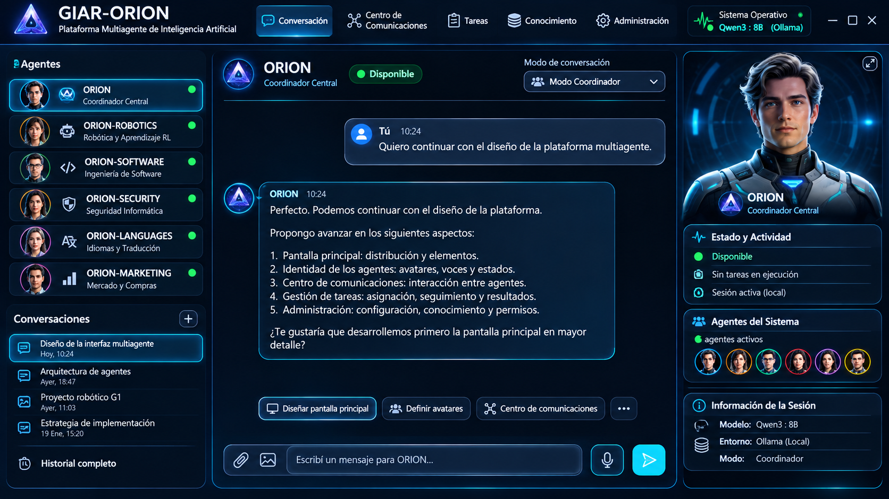

# GIAR-ORION --- Especificación funcional maestra

**Código:** GIAR-ORION-DES-001\
**Versión:** 0.5\
**Fecha:** 11/11/2026\
**Estado:** Borrador consolidado para revisión\
**Alcance:** Diseño funcional conceptual de los módulos 1 a 24.

## Control de versiones del documento

| Versión | Fecha | Cambios | Estado |
|---|---|---|---|
| 0.1 | 10/11/2026 | Consolidación inicial de decisiones conversadas para los módulos 1–24; identificación de pendientes y propuestas no aprobadas. | Borrador |
| 0.3 | 10/11/2026 | Desarrollo funcional del Módulo 19 con quince decisiones aprobadas; actualización de pendientes y próxima etapa. | Borrador consolidado para revisión |
| 0.4 | 11/11/2026 | Incorporación de la primera especificación funcional aprobada de ORION CORE: diez componentes, doce decisiones y criterios transversales. | ORION CORE aprobado funcionalmente; ingeniería pendiente |
| 0.5 | 11/11/2026 | Incorporación de la especificación funcional del Módulo 20, diez componentes, decisiones, contratos, flujos, requisitos, auditorías y pendientes técnicos. | M20 aprobado funcionalmente en el alcance documentado; diseño técnico e implementación pendientes |

## Criterios de lectura

-   **Aprobado funcionalmente:** decisión aceptada; no significa
    implementado ni probado.
-   **Aprobado conceptualmente / pendiente de detalle:** se aceptó
    incorporar el módulo, pero falta especificarlo.
-   **En definición:** hay decisiones pendientes.
-   **Propuesto:** recomendación no aprobada expresamente.
-   **Pendiente:** falta decisión o especificación.

Este documento registra diseño conceptual. No afirma que exista código,
estructura de carpetas o funcionalidad implementada.

# 1. Visión general

GIAR-ORION se concibe como una plataforma local multiagente para
investigación, desarrollo, robótica, software, seguridad, idiomas,
mercado y futuras especialidades. ORION coordina agentes, tareas,
permisos, recursos, proyectos, evidencias y resultados.

## Principios acordados

1.  ORION es el coordinador central y no se deshabilita mediante
    administración ordinaria.
2.  Agentes especializados tienen identidad, configuración, memoria,
    conocimiento, herramientas, logs, avatar y voz propios.
3.  Los servicios comunes se centralizan cuando convenga.
4.  No duplicar innecesariamente instancias del mismo modelo LLM.
5.  Funcionamiento offline como requisito; Internet es opcional.
6.  Compatibilidad Windows 11 y Ubuntu desde el diseño.
7.  Escalabilidad desde una GPU a varias GPU y equipos en red local.
8.  Autonomía configurable, siempre sujeta a objetivos, permisos,
    recursos y límites.
9.  Seguridad por diseño, auditoría y autenticación reforzada para
    operaciones sensibles.
10. Trazabilidad de tareas, archivos, experimentos, cambios, evidencias
    y decisiones.
11. Preservar originales y versiones aprobadas.
12. Medir y probar antes de modificar arquitectura.
13. Separar recuperación RAG, memoria, generación LLM, verificación,
    decisión, aprendizaje y entrenamiento.
14. Los objetivos principales, cambios críticos, acciones destructivas y
    operaciones sensibles requieren autorización.
15. Mantener documentación versionada y una bitácora de trabajo real.

## Agentes iniciales

  -----------------------------------------------------------------------
  Agente                              Responsabilidad
  ----------------------------------- -----------------------------------
  ORION                               Coordinador central, políticas,
                                      asignación, permisos, supervisión y
                                      consolidación.

  ORION-ROBOTICS                      Robótica, simulación, RL,
                                      investigación y desarrollo.

  ORION-SOFTWARE                      Programación e ingeniería de
                                      software.

  ORION-SECURITY                      Seguridad informática y análisis de
                                      amenazas.

  ORION-LANGUAGES                     Traducción, interpretación y
                                      enseñanza de idiomas.

  ORION-MARKETING                     Investigación de mercado,
                                      proveedores, productos,
                                      comparaciones y costos.
  -----------------------------------------------------------------------

Cada agente tiene identidad y contexto propios. La inferencia LLM y
otros servicios compartidos se administran centralmente.

## Modos de interacción

-   **Coordinador:** el usuario conversa con ORION, que deriva tareas.
-   **Agente directo:** el usuario selecciona un agente; ORION sigue
    coordinando internamente permisos y supervisión.
-   **Colaborativo:** varios agentes trabajan juntos bajo coordinación
    de ORION.

Los agentes pueden comunicarse directamente en tareas permitidas. ORION
interviene en asignación, prioridades, permisos, operaciones sensibles,
conflictos y consolidación. Los desacuerdos deben hacerse visibles; no
se convierten opiniones en evidencias.

## Contexto técnico de referencia

  Elemento               Referencia conocida
  ---------------------- --------------------------------------
  SO actual              Windows 11
  SO futuro              Ubuntu
  GPU actual             NVIDIA RTX 5070 Laptop, 8 GB VRAM
  Runtime local          Ollama
  Modelo de referencia   Qwen3:8B
  Conectividad           Local/offline, Internet opcional
  Red local              Puede conectar computadora y celular
  Escalabilidad          Varias GPU en el futuro

Este contexto no limita el diseño a ese hardware.

## ORION CORE — PRIMERA VERSIÓN

| Versión | Cambios realizados | Estado | Próximo trabajo |
|---|---|---|---|
| 0.1 | Primera especificación funcional de ORION CORE: diez componentes y doce decisiones aprobadas. | Aprobado funcionalmente; diseño técnico e implementación pendientes. | Definir arquitectura interna, contratos, esquemas de datos, políticas operativas y pruebas. |

### Objetivo y alcance

ORION CORE constituye el núcleo de coordinación y operación de GIAR-ORION. Proporciona los servicios fundamentales para iniciar y cerrar la plataforma, identificar agentes, recibir y distribuir solicitudes, coordinar tareas, comunicarse con el Model Manager, administrar estados, registrar eventos, aplicar permisos, conservar el estado operativo y ofrecer interfaces estables a los módulos presentes y futuros.

ORION CORE no reemplaza a los gestores especializados. Coordina sus interacciones y aplica las políticas comunes; la recuperación documental, memoria, razonamiento, validación, investigación, ejecución de herramientas y otras funciones específicas permanecen en sus módulos correspondientes.

### Diez componentes funcionales

1. **Inicialización y cierre:** administra el ciclo de vida de la plataforma y sus servicios, contemplando inicio y cierre ordenados y recuperación del estado operativo cuando corresponda.
2. **Registro e identificación de agentes:** mantiene el registro de agentes reconocidos por la plataforma y la información necesaria para identificarlos y conocer su disponibilidad/configuración operativa.
3. **Recepción y distribución de solicitudes:** recibe solicitudes y las encamina al agente o servicio correspondiente según el tipo de tarea y las condiciones operativas.
4. **Coordinación de tareas:** coordina la asignación y seguimiento de tareas, dependencias, colaboración y supervisión entre agentes.
5. **Comunicación con Model Manager:** utiliza una API interna para solicitar servicios de inferencia al Model Manager centralizado, evitando que cada agente administre por separado instancias del modelo.
6. **Gestión de estados:** administra estados jerárquicos de plataforma, agentes y tareas, de manera coherente y auditable.
7. **Registro de eventos y errores:** registra eventos operativos, incidencias y errores con niveles de detalle configurables, preservando los registros críticos de auditoría.
8. **Control de permisos:** verifica permisos y autorizaciones antes de permitir operaciones, aplicando políticas comunes y controles reforzados para acciones sensibles.
9. **Persistencia:** conserva la información necesaria para recuperar el estado de la plataforma, agentes y tareas, verificando integridad antes de reanudar operaciones.
10. **Interfaces con módulos futuros:** expone contratos e interfaces internas estables para integrar los módulos actuales y futuras extensiones sin acoplar innecesariamente sus implementaciones.

### Decisiones funcionales aprobadas

Las siguientes doce decisiones constituyen el alcance funcional aprobado para la primera versión. Su aprobación no implica selección de tecnologías, diseño técnico detallado, código implementado ni pruebas superadas.

**ORION-CORE-001 — Inicialización y cierre inteligentes.** El ciclo de vida de la plataforma deberá contemplar el orden de inicio y cierre de sus componentes y servicios, considerando dependencias y estado operativo. El cierre debe ser controlado y evitar presentar como finalizadas tareas que hayan quedado interrumpidas.

**ORION-CORE-002 — Registro e identificación híbridos de agentes.** La plataforma contará con un mecanismo central de registro e identificación. La incorporación de agentes podrá realizarse de forma manual y mediante mecanismos automáticos controlados; el registro deberá permitir reconocer al agente y consultar su condición operativa.

**ORION-CORE-003 — Recepción y distribución inteligente de solicitudes.** Las solicitudes se recibirán en un punto de coordinación y se derivarán según su naturaleza, especialidad requerida y condiciones de operación. La distribución deberá considerar la disponibilidad y habilitación del agente, sus permisos, herramientas y recursos.

**ORION-CORE-004 — Coordinación híbrida de tareas.** ORION CORE coordinará tareas centralmente, permitiendo que los agentes colaboren directamente cuando esté permitido. La coordinación deberá contemplar dependencias, seguimiento y escalamiento de situaciones que requieran intervención de ORION o del usuario.

**ORION-CORE-005 — Comunicación con Model Manager centralizado.** Los agentes solicitarán inferencia mediante una API interna común. El Model Manager administrará centralmente los modelos y sus recursos; el diseño deberá permitir operación local/offline y evitar instancias duplicadas innecesarias.

**ORION-CORE-006 — Gestión jerárquica de estados.** Los estados se organizarán en niveles coherentes para plataforma, agentes y tareas. Los cambios deberán ser consistentes, trazables y compatibles con la recuperación de operaciones.

**ORION-CORE-007 — Registro configurable de eventos y errores.** Se contemplan niveles de registro resumido, intermedio y completo. La configuración del detalle visible/operativo no deberá desactivar la auditoría de eventos críticos ni eliminar la trazabilidad necesaria.

**ORION-CORE-008 — Control híbrido de permisos.** Los permisos se verificarán antes de ejecutar operaciones. Se combinarán políticas centrales de ORION con permisos específicos por agente, tarea o recurso; las operaciones sensibles requerirán autorización según su riesgo. Las autorizaciones y decisiones de acceso deberán quedar registradas.

**ORION-CORE-009 — Persistencia inteligente.** La plataforma conservará el estado necesario para continuar o recuperar tareas y servicios. La recuperación deberá comprobar integridad y consistencia, reanudando solo desde estados válidos; si el estado no es confiable, deberá detener la reanudación automática y escalar el caso.

**ORION-CORE-010 — Arquitectura híbrida y modular.** ORION CORE combinará coordinación central de las funciones comunes con componentes modulares e independientes. Los módulos se integrarán mediante contratos estables, preservando independencia funcional y evitando acoplamiento innecesario.

**ORION-CORE-011 — Coordinación sujeta a disponibilidad y recursos.** La asignación y continuidad de solicitudes/tareas deberá considerar elegibilidad de agentes, disponibilidad de herramientas y recursos, dependencias y posibles conflictos. Si no existen condiciones suficientes, la solicitud deberá quedar en espera, reencaminarse o escalarse según corresponda, sin forzar una ejecución inválida.

**ORION-CORE-012 — Trazabilidad y recuperación auditables.** Los cambios relevantes de estado, asignaciones, autorizaciones, eventos y recuperaciones deberán conservar trazabilidad. Los registros podrán configurarse por nivel, pero deberán preservarse los datos críticos para auditoría, diagnóstico y recuperación.

### Criterios funcionales transversales

- Modularidad y contratos estables entre componentes.
- Coordinación central cuando la función requiera políticas o consistencia global, sin impedir colaboración directa autorizada entre agentes.
- Independencia funcional de los módulos especializados.
- Verificación de permisos antes de operar.
- Estados y tareas recuperables únicamente después de validar integridad y consistencia.
- Registros configurables, con conservación obligatoria de la auditoría crítica.
- Funcionamiento local/offline como requisito; conectividad externa opcional.
- Compatibilidad de diseño con Windows 11 y Ubuntu.

### Límites y dependencias

ORION CORE depende de Model Manager para inferencia; Task/Resource Manager para planificación y disponibilidad de recursos; Administration & Configuration Manager para configuración y políticas administrativas; Security Core para controles de seguridad; Session/Recovery y Backup & Recovery para persistencia y recuperación; y los módulos especializados para sus funciones de dominio. Los contratos concretos y límites de responsabilidad se definirán en la arquitectura técnica.

### Pendientes de ingeniería

- Definir el ciclo técnico de arranque y cierre y el manejo de dependencias.
- Especificar el esquema de registro e identificación de agentes.
- Definir contratos de solicitudes, tareas, estados y eventos.
- Especificar la API interna con Model Manager y sus políticas de cola/concurrencia.
- Definir el modelo común de permisos y autorización.
- Precisar persistencia, validación de integridad y puntos de recuperación.
- Establecer métricas, pruebas de integración, recuperación y auditoría.

# 2. Especificación por módulos

Cada módulo incluye historial de versiones al comienzo. La versión 0.1
indica consolidación funcional inicial, no implementación. La columna
"Próximo trabajo" señala la siguiente actividad de diseño o ingeniería.

## MÓDULO 1 --- INTERFAZ PRINCIPAL

  -------------------------------------------------------------------------
  Versión           Cambios realizados  Estado            Próximo trabajo
  ----------------- ------------------- ----------------- -----------------
  0.1               Aprobada línea      Aprobado          Especificar
                    visual profesional  funcionalmente    pantallas,
                    tecnológica +                         navegación,
                    futurista; tema                       componentes y
                    grafito/azul,                         comportamiento
                    acentos                               responsive.
                    cian/violeta; panel                   
                    agentes, chat                         
                    central,                              
                    avatar/actividad,                     
                    barra superior y                      
                    entrada texto/voz.                    

  -------------------------------------------------------------------------

**Objetivo y detalles** - Interfaz principal para usuario, ORION y
agentes. - Panel izquierdo: agentes; centro: conversación; panel
derecho: avatar 3D, identidad y actividad. - Barra superior: navegación,
estado general e indicador móvil. - Seis agentes iniciales visibles y
seleccionables. - Estados: disponible, ocupado, comunicándose,
desconectado, deshabilitado y error. - Accesos: comunicaciones, tareas,
conocimiento, administración, proyectos y reportes. - Niveles de
visualización: - Desarrollo: intervenciones, comunicaciones, resultados
y procesos. - Intermedio: agentes, tareas y avances principales. -
Producción: respuesta final principalmente. - Ocultar informes no
desactiva logs ni auditoría. - Indicador móvil: gris (no habilitado/no
vinculado), verde (conectado), amarillo (habilitado pero desconectado),
rojo (error). Al abrirlo: estado, dispositivo, Wi-Fi, última
comunicación, habilitar/deshabilitar y vincular. - Pendiente:
resolución, accesibilidad, navegación completa y especificación visual
definitiva.


### Referencia visual y propuesta de pantalla principal

La siguiente captura se incorpora como **referencia visual del diseño consensuado** para la interfaz principal de GIAR-ORION. Debe conservarse como referencia durante la implementación; no implica que la interfaz ya esté programada.



**Criterios visuales representados**
- **Barra superior:** identidad GIAR-ORION, navegación principal y estado del sistema/modelo.
- **Panel izquierdo:** listado de los seis agentes iniciales, identidad, especialidad y estado; debajo, conversaciones e historial.
- **Área central:** agente o conversación activa, selector de modo (Coordinador, agente directo o colaborativo), mensajes y accesos contextuales.
- **Panel derecho:** avatar del agente activo, estado y actividad, agentes del sistema e información de sesión.
- **Zona inferior:** adjuntos, entrada de texto, activación de voz y envío.
- **Estética:** tema oscuro grafito/azul, acentos cian y azul eléctrico, componentes delimitados y jerarquía visual tecnológica/futurista.

**Alcance de la referencia:** la imagen es una propuesta visual de referencia, no una especificación pixel-perfect ni evidencia de una interfaz funcional. La distribución y los elementos consensuados deben guiar el diseño responsive para escritorio y su adaptación a móvil.

**Prototipo interactivo (iframe):** queda previsto incorporar aquí el prototipo navegable. En esta actualización no se recibió una URL pública/local ni el código `iframe`; por lo tanto, no se inserta un marco vacío ni se inventa un destino. Cuando se disponga del enlace o del código de inserción, se agregará en esta sección.

## MÓDULO 2 --- CENTRO DE COMUNICACIONES

  -----------------------------------------------------------------------
  Versión           Cambios           Estado            Próximo trabajo
                    realizados                          
  ----------------- ----------------- ----------------- -----------------
  0.1               Centro con lista  Aprobado          Definir
                    de                funcionalmente    protocolo,
                    agentes/grupos,                     estados,
                    conversación y                      persistencia,
                    detalles; tipos                     búsqueda y
                    consulta,                           adjuntos.
                    colaboración,                       
                    transferencia y                     
                    supervisión;                        
                    registro.                           

  -----------------------------------------------------------------------

**Detalles** - Comunicaciones iniciadas por ORION, agente autorizado o
usuario. - Modelo híbrido: comunicación directa permitida entre agentes,
con supervisión central de ORION. - Los archivos compartidos no entran
automáticamente al RAG; pasan por Knowledge Manager. - Registro mínimo:
ID conversación, emisor/receptor, fecha, motivo, mensajes, archivos,
tarea y resultado. - Pendiente: mensajería síncrona/asíncrona, colas,
reintentos, retención y contratos de comunicación.

## MÓDULO 3 --- TASK MANAGER + RESOURCE MANAGER + MODEL MANAGER

  ------------------------------------------------------------------------
  Versión           Cambios realizados Estado            Próximo trabajo
  ----------------- ------------------ ----------------- -----------------
  0.1               Gestión coordinada Aprobado          Definir
                    de tareas,         funcionalmente    contratos, colas,
                    recursos e                           prioridades,
                    inferencia; no                       concurrencia y
                    duplicar                             métricas.
                    innecesariamente                     
                    Qwen3 por agente.                    

  ------------------------------------------------------------------------

**Detalles** - Task Manager: tareas, dependencias, prioridad, progreso,
estado, cancelación, suspensión y reanudación. - Resource Manager: CPU,
RAM, GPU, VRAM, disponibilidad y ejecuciones. - Model Manager: modelos,
instancias/servicios de inferencia, solicitudes, concurrencia y
versiones. - Diferenciar concurrencia de agentes/tareas de concurrencia
de inferencia. - Una GPU inicialmente; varias en el futuro. Los agentes
solicitan recursos a los managers y no dependen de hardware concreto. -
Ante falta de recursos, ordenar prioridades/colas, informar al usuario y
permitir intervención. - Panel: GPU, VRAM, CPU, RAM, modelos activos,
cola y ejecuciones. - Pendiente: planificación, cuotas, límites por
usuario/proyecto y políticas de memoria GPU.

## MÓDULO 4 --- KNOWLEDGE MANAGER

  -----------------------------------------------------------------------
  Versión           Cambios           Estado            Próximo trabajo
                    realizados                          
  ----------------- ----------------- ----------------- -----------------
  0.1               Bibliotecas       Aprobado          Definir esquema,
                    privadas,         funcionalmente    motor vectorial,
                    compartidas y                       pipeline, índices
                    globales;                           y pruebas.
                    permisos                            
                    granulares;                         
                    pipeline                            
                    documental;                         
                    evaluación de                       
                    recuperación.                       

  -----------------------------------------------------------------------

**Detalles** - Bibliotecas privadas por agente, compartidas y
globales. - Acceso libre a biblioteca propia; autorización para
bibliotecas privadas ajenas; permisos en compartidas/globales. -
Permisos: READ, WRITE, UPDATE, DELETE, SHARE; posibilidad de permisos
temporales por proyecto. - Ingesta: validación, extracción,
normalización, chunking, embeddings, indexación, pruebas y validación. -
Estados: pendiente, validando, procesando, indexando, indexado, indexado
con advertencias, error, desactualizado. - Agentes pueden proponer
conocimiento; bandeja de revisión; incorporación permanente autorizada
por usuario o política. - Originales separados de índices; referencias
cuando sea posible. - Pruebas RAG: relevancia, precisión de fragmentos,
cobertura, recuperación crítica, latencia y comparación de versiones. -
Distinguir errores RAG de generación LLM. - UI: bibliotecas, documentos,
procesamiento, validación y propuestas. - Pendiente: búsqueda híbrida,
reranking, metadatos, versionado y métricas.

## MÓDULO 5 --- MEMORY MANAGER

  --------------------------------------------------------------------------
  Versión           Cambios realizados   Estado            Próximo trabajo
  ----------------- -------------------- ----------------- -----------------
  0.1               Modelo híbrido de    Aprobado          Definir ciclo de
                    guardado; cuatro     funcionalmente    vida,
                    tipos de memoria;                      recuperación,
                    memoria                                consolidación,
                    privada/compartida y                   contradicciones y
                    separación de                          permisos.
                    Knowledge.                             

  --------------------------------------------------------------------------

**Detalles** - Working: tarea actual. - Episodic: experiencias. -
Semantic: hechos, relaciones y conclusiones. - Procedural: métodos y
procedimientos. - Memoria privada por agente y compartida. -
`Knowledge/` es biblioteca documental/RAG; `Memory/` es memoria
experiencial/operativa. - Memory Retriever separado de Knowledge
Retriever; pueden combinarse, con fuentes y evaluaciones
diferenciadas. - Estructura conceptual: `Memory/Working`, `Episodic`,
`Semantic`, `Procedural`, `Indexes`; `Knowledge/Documents`,
`Embeddings`, `Indexes`, `Metadata`. - Memoria no modifica
automáticamente pesos del LLM ni equivale a entrenamiento. - Metadatos:
origen, confiabilidad, referencias a tareas/documentos/experimentos;
detectar duplicados/contradicciones, archivar, versionar, buscar y
borrar con permisos. - Guardado automático de recuerdos operativos de
bajo riesgo; conclusiones permanentes, procedimientos y memoria
compartida requieren validación según políticas. - Pendiente: esquema,
confianza, caducidad, consolidación, privacidad y pruebas.

## MÓDULO 6 --- SECURITY & THREAT DETECTION

  --------------------------------------------------------------------------------
  Versión           Cambios realizados         Estado            Próximo trabajo
  ----------------- -------------------------- ----------------- -----------------
  0.1               Arquitectura híbrida con   Aprobado          Definir amenazas,
                    herramientas consolidadas  funcionalmente    adaptadores,
                    y núcleo propio de                           telemetría,
                    supervisión/correlación;                     respuesta y
                    Windows y Ubuntu.                            autorizaciones.

  --------------------------------------------------------------------------------

**Detalles** - Núcleo ORION SECURITY CORE común y adaptadores por SO. -
Windows: Defender/API, firewall, Event Logs (candidatos). - Ubuntu:
ClamAV u otras herramientas, firewall, journald, auditd (candidatos). -
ORION-SECURITY analiza; el núcleo aplica políticas. No delegar toda la
seguridad al agente. - Amenazas: intrusiones, malware, virus,
ransomware, troyanos, spyware, phishing, IP/dominios sospechosos,
escaneo de puertos, ataques de red, procesos/servicios, startup, cambios
de archivos y puertos. - Respuestas: informativo, advertencia, alto,
crítico. - Evitar borrar archivos o detener procesos sin validación;
contención automática solo con políticas explícitas. - Offline: análisis
local y firmas disponibles; inteligencia online opcional. - Perfiles
Normal/Alto/Crítico fueron propuestos, no formalmente aprobados. - No
prometer detección total ni reemplazo del antivirus del SO. - Pendiente:
matriz de riesgo, contención, telemetría, privacidad, pruebas y
perfiles.

## MÓDULO 7 --- VOICE & AVATAR ENGINE

  -----------------------------------------------------------------------
  Versión           Cambios           Estado            Próximo trabajo
                    realizados                          
  ----------------- ----------------- ----------------- -----------------
  0.1               Avatares 3D       Aprobado          Comparar
                    interactivos;     funcionalmente    tecnologías,
                    STT/TTS; voces                      latencia,
                    por agente;                         calidad, consumo
                    servicios                           y compatibilidad.
                    compartidos y                       
                    estados visuales                    
                    reales.                             

  -----------------------------------------------------------------------

**Detalles** - STT, TTS, push-to-talk, conversación continua, VAD e
interrupción de TTS. - Voz propia por agente. - Avatar humanoide 3D con
lip-sync, parpadeo, cabeza, mirada, expresiones y gestos discretos. - El
avatar refleja estados reales: escuchando, procesando, hablando,
comunicándose y error. - Componentes separados: Agent (lógica), Voice
Engine (STT/TTS), Avatar Engine (visual/animación). - STT/TTS
compartidos cuando sea conveniente. - Candidatos: Whisper, Piper/Kokoro,
Three.js, VAD y WebSocket; aún no seleccionados. - Windows, Ubuntu y
móvil; escritorio completo y versión móvil adaptada. - Resource Manager
controla CPU/GPU. - Pendiente: pruebas de calidad, latencia, consumo,
licencias y offline.

## MÓDULO 8 --- PROJECT & WORKFLOW MANAGER

  -----------------------------------------------------------------------
  Versión           Cambios           Estado            Próximo trabajo
                    realizados                          
  ----------------- ----------------- ----------------- -----------------
  0.1               Modelo híbrido;   Aprobado          Definir ciclo,
                    línea base        funcionalmente    esquema, Git,
                    aprobada; cambios                   aprobaciones y
                    importantes                         flujos.
                    sujetos a                           
                    aprobación;                         
                    tareas,                             
                    dependencias,                       
                    versiones y                         
                    estructura de                       
                    proyecto.                           

  -----------------------------------------------------------------------

**Detalles** - ORION planifica/reorganiza dentro de objetivos y
permisos. - Aprobación necesaria para cambiar objetivos, requisitos
aprobados, eliminar/reemplazar entregables, cambios importantes de
arquitectura, operaciones destructivas y finalizar proyecto. - Línea
base: objetivos, requisitos, alcance, arquitectura, entregables y
restricciones. No se cambia unilateralmente. - Ciclo: inicio, análisis,
planificación, desarrollo, validación, integración, evaluación y
finalización. - Tarea: ID, nombre, descripción, responsable, prioridad,
estado, dependencias, fechas y resultados. - Ejecución paralela
coordinada con Resource Manager. - Git/versionado, identificación de
agente y protección de originales/versiones aprobadas. - Persistencia
integrada con Session Manager. - Estructura conceptual:
`PROJECTS/<proyecto>/config`, `requirements`, `planning`, `tasks`,
`documents`, `experiments`, `results`, `versions`, `reports`. -
Pendiente: plantillas, estados, esquema y reglas de colaboración.

## MÓDULO 9 --- REPORTING & ANALYTICS

  -----------------------------------------------------------------------
  Versión           Cambios           Estado            Próximo trabajo
                    realizados                          
  ----------------- ----------------- ----------------- -----------------
  0.1               Objetivos,        En definición     Resolver
                    evidencias,                         aprobación y
                    referencias,                        completar
                    formatos y                          validación,
                    estados de                          plantillas y
                    informe                             formatos.
                    definidos; falta                    
                    decidir                             
                    aprobación.                         

  -----------------------------------------------------------------------

**Detalles** - Informes técnicos, investigación, experimentos,
comparativas, código, seguridad, rendimiento, mercado, proyectos y
colaboración. - Evidencias: dato verificado, resultado experimental,
conclusión fundamentada, hipótesis, inferencia del modelo e información
no verificada. - Referencias a documentos, RAG, web, archivos, scripts,
experimentos y agentes. - Formatos previstos: Markdown, PDF, DOCX, XLSX,
CSV, HTML, JSON, PPTX. - Historial/versiones; informes aprobados no se
sobrescriben. - Estados: Borrador, Revisado, Validado; validar requiere
criterios explícitos, no solo revisión lingüística. - Pendiente: se
planteó A usuario, B ORION, C híbrido. Se recomendó C (rutinarios con
validación automática; científicos, experimentales, seguridad y
decisiones importantes con aprobación del usuario), pero no está
aceptada expresamente. - File Manager es transversal, no subordinado a
Reporting.

## MÓDULO 10 --- FILE MANAGER

  ------------------------------------------------------------------------------------------
  Versión           Cambios realizados                   Estado            Próximo trabajo
  ----------------- ------------------------------------ ----------------- -----------------
  0.1               Lectura/análisis y                   Aprobado          Seleccionar
                    edición/generación; servicio         funcionalmente    bibliotecas,
                    central; autonomía configurable por                    adaptadores,
                    agente/proyecto/formato/operación.                     límites y pruebas
                                                                           por formato.

  ------------------------------------------------------------------------------------------

**Detalles** - Lee, analiza, crea, edita, convierte, comprime,
descomprime, valida integridad y versiona. - Formatos contemplados: -
Documentos: PDF, DOCX, TXT, MD, ODT, RTF. - Hojas: XLSX, XLS, CSV,
ODS. - Presentaciones: PPTX, PPT, ODP. - Imágenes: PNG, JPG, JPEG, BMP,
TIFF, WEBP, SVG. - Comprimidos: ZIP, 7Z, TAR, GZ. - Código/datos: PY, C,
C++, JS, HTML, CSS, JSON, XML. - Audio: WAV, MP3, FLAC, OGG, M4A. -
Video: MP4, AVI, MKV, MOV, WEBM. - 3D: STL, OBJ, GLTF, GLB, 3DM. -
Comprender contenido requiere adaptadores especializados; abrir un
archivo no implica comprenderlo. - Imagen: OCR, diagramas/gráficos,
comparación, conversión y redimensionamiento. - ZIP: inspección,
extracción, análisis, duplicados, creación/modificación. - Protección:
ZIP bombs, path traversal, archivos maliciosos y límites de tamaño. -
Originales protegidos; edición genera copia/nueva versión;
reemplazo/eliminación según permisos. - Arquitectura propuesta: File
Detector, Reader, Writer, Converter, Archive Manager, Security Manager,
Version Manager y Format Adapters. - Permisos: READ, ANALYZE, CREATE,
WRITE, CONVERT, COMPRESS, DELETE, SHARE. - Niveles: automático,
autorizado por proyecto, requiere autorización, prohibido. - Bibliotecas
candidatas: PyMuPDF/pypdf, python-docx, openpyxl, python-pptx, Pillow,
OpenCV, Tesseract, zipfile, py7zr, FFmpeg, librosa, trimesh, pygltflib,
rhino3dm, BeautifulSoup, lxml y Tree-sitter. No son selección
definitiva. - Servicio transversal a Knowledge, Memory, Project,
Reporting, agentes y Security. - Pendiente: selección técnica y
validación formato por formato.

## MÓDULO 11 --- WEB & RESEARCH ENGINE

  -----------------------------------------------------------------------
  Versión           Cambios           Estado            Próximo trabajo
                    realizados                          
  ----------------- ----------------- ----------------- -----------------
  0.1               Investigación     Aprobado          Definir
                    online/offline,   funcionalmente    conectores,
                    fuentes                             límites,
                    múltiples,                          extracción,
                    clasificación de                    evaluación de
                    evidencia y                         fuentes y defensa
                    autonomía                           prompt injection.
                    supervisada.                        

  -----------------------------------------------------------------------

**Detalles** - Fuentes: buscadores, GitHub/GitLab, índices académicos,
documentación oficial, fabricantes y bases técnicas. - Offline:
bibliotecas, repositorios descargados, documentación local, Knowledge y
Memory. Indicar fecha de obtención/última verificación. - Capacidades:
buscar, consultar, analizar páginas/repositorios, descargar documentos
autorizados, extraer, comparar, contrastar, verificar y generar
informes. - Evidencias: verificada, respaldada, contradictoria,
hipótesis, inferencia y no verificada. - Metadatos: URL/ubicación,
título/autor, publicación, consulta, fragmento de respaldo y agente. -
Una respuesta del LLM no es evidencia por sí misma. - Autonomía
aprobada: agentes inician investigación si necesitan información; ORION
supervisa prioridades, consultas, descargas, recursos, permisos, agentes
y consolidación. - Seguridad: páginas/documentos son contenido no
confiable; protección prompt injection; validar descargas; no ejecutar
automáticamente; límites y auditoría. - Pendiente: conectores, APIs,
términos de uso, confiabilidad y caché offline.

## MÓDULO 12 --- LEARNING & ADAPTATION ENGINE

  ---------------------------------------------------------------------------------
  Versión           Cambios realizados          Estado            Próximo trabajo
  ----------------- --------------------------- ----------------- -----------------
  0.1               Aprendizaje integral:       Aprobado          Definir métricas,
                    operativo, optimización de  funcionalmente    ciclo, datasets,
                    agentes y                                     aceptación y
                    entrenamiento/fine-tuning                     límites.
                    justificado.                                  

  ---------------------------------------------------------------------------------

**Detalles** - Categorías: experiencial, procedimental, estratégica,
colaborativa y adaptativa. - Evaluación: precisión, calidad de fuentes,
objetivos, errores, tiempo, recursos, intervención humana, pruebas y
entregables. - Métricas diferentes según especialidad. - Separación: -
Knowledge/RAG: recuperación documental. - Memory: experiencias. -
Learning: evaluación/propuesta de mejora. - LLM:
interpretación/generación. - Training: modificación de pesos. -
Experimentación: hipótesis, diseño, variables, pruebas autorizadas,
registro, comparación, reproducibilidad, resultados negativos y
conclusiones. - Aprendizaje integral aprobado: 1. Operativo. 2.
Optimización de prompts, procedimientos, estrategias y RAG. 3.
Fine-tuning, LoRA, QLoRA y modelos especializados. - Model Training
Manager propuesto: datasets, validación, modelos base, fine-tuning,
LoRA/QLoRA, evaluación antes/después, comparación, versionado,
aprobación y conservación de originales. - Ciclo de mejora: hipótesis,
preparación, prueba, comparación, evaluación, aprobación cuando
corresponda, adopción o descarte. - Hardware actual: RTX 5070 Laptop con
8 GB VRAM; evaluar modelos pequeños, cuantización y técnicas eficientes;
no asumir GPU ilimitada. - Pendiente: métricas, datasets, criterios y
herramientas.

## MÓDULO 13 --- API & INTEGRATION ENGINE

  -----------------------------------------------------------------------
  Versión           Cambios           Estado            Próximo trabajo
                    realizados                          
  ----------------- ----------------- ----------------- -----------------
  0.1               Conectores        Aprobado          Verificar APIs,
                    independientes y  funcionalmente    capacidades,
                    autonomía                           contratos,
                    configurable;                       permisos y
                    agregados Webots                    pruebas.
                    y Solid Edge.                       

  -----------------------------------------------------------------------

**Detalles** - Componentes propuestos: API Manager, Connector Manager,
Device Manager, Data Exchange, Command Executor, Event Manager, Security
Manager. - Robótica/simulación: CoppeliaSim, MuJoCo, Webots, ROS 2. -
CAD: Rhino 3D y Solid Edge. - Desarrollo: VS Code, Git, GitHub; GitLab
posible. - IA: Ollama. - Hardware: Arduino, ESP32, sensores y robots. -
Niveles: consulta, interacción operativa y control físico. - Autonomía
aprobada por agente, aplicación, proyecto, dispositivo, operación y
riesgo. - Simuladores: experimentos, parámetros autorizados, iniciar
simulación y analizar resultados. - Hardware físico: controles
reforzados; permiso de simulación no habilita control real. - Seguridad:
permisos por conector, auditoría, credenciales seguras, aprobación
destructiva y bloqueo/desconexión. - Pendiente: comprobar API real,
autenticación, eventos y límites de cada aplicación.

## MÓDULO 14 --- NOTIFICATION & EVENT MANAGER

  ------------------------------------------------------------------------
  Versión           Cambios realizados Estado            Próximo trabajo
  ----------------- ------------------ ----------------- -----------------
  0.1               Gestión autónoma   Aprobado          Definir esquema,
                    de                 funcionalmente    colas,
                    acontecimientos;                     persistencia,
                    acciones                             deduplicación y
                    correctivas                          reglas.
                    autorizadas,                         
                    coordinación y                       
                    notificación                         
                    PC/móvil.                            

  ------------------------------------------------------------------------

**Detalles** - Categorías: agentes, tareas, investigación, experimentos,
seguridad, recursos, proyectos, autorizaciones y plataforma. -
Prioridades: informativo, normal, importante, alto y crítico. - Centro
de notificaciones: nuevas, historial, filtros por
agente/proyecto/prioridad, marcar leídas, acceder a tarea y ver
detalles. - Móvil por Wi-Fi local sin cloud; almacenar y sincronizar al
reconectar. - Autorizaciones con vencimiento; no ejecutar una
autorización expirada al reconectar. - Autonomía aprobada: ORION
interpreta eventos, inicia acciones permitidas, convoca agentes,
crea/reasigna tareas y pide intervención cuando corresponda. - Ejemplo:
experimento falla, evento registrado, ORION analiza, convoca software,
crea diagnóstico y coordina continuación. - Evitar ciclos infinitos: ID,
límites de reintentos y de convocatorias. - Pendiente: modelo de
eventos, broker/cola y reglas.

## MÓDULO 15 --- BACKUP & RECOVERY MANAGER

  ----------------------------------------------------------------------------
  Versión           Cambios realizados     Estado            Próximo trabajo
  ----------------- ---------------------- ----------------- -----------------
  0.1               Sistema híbrido,       Aprobado          Definir
                    estrategia 3-2-1 de    funcionalmente    herramientas,
                    referencia,                              cifrado,
                    frecuencia/retención                     retención,
                    inteligentes y                           restauración y
                    verificación.                            pruebas.

  ----------------------------------------------------------------------------

**Detalles** - Destinos: disco local, externo, NAS, otra computadora LAN
y remoto opcional. - Offline sin dependencia cloud. - Referencia 3-2-1:
tres copias, dos medios, una externa al equipo. - Modalidades: completa,
incremental, diferencial y por evento. - Eventos: cambios críticos,
actualizaciones, modelos, procedimientos, administración y proyectos. -
Proteger configuración, agentes, memoria, bibliotecas, proyectos,
experimentos, modelos según disponibilidad, código y logs. - Índices RAG
pueden reconstruirse; no necesariamente duplicarlos en cada backup. -
Recuperación de cierre inesperado, error de agente, corrupción, fallo de
plataforma y fallo de equipo. - Verificación: SHA-256, integridad,
fecha/versión, componentes, detección de copias incompletas y pruebas de
restauración. - Migración Windows/Ubuntu con validación de
dependencias. - Frecuencia/retención inteligente según criticidad,
cambios, actividad, riesgo, espacio y última copia. Respetar límites del
usuario; no borrar copias necesarias por falta de espacio. - Panel:
último/próximo backup, integridad, espacio, destinos, versiones, alertas
y restauraciones. - Pendiente: cifrado, inmutabilidad, herramientas y
restauración completa.

## MÓDULO 16 --- ADMINISTRATION & CONFIGURATION MANAGER

  -----------------------------------------------------------------------
  Versión           Cambios           Estado            Próximo trabajo
                    realizados                          
  ----------------- ----------------- ----------------- -----------------
  0.1               Administración    Aprobado          Definir esquema
                    centralizada y    funcionalmente    de configuración,
                    autonomía                           roles, secretos y
                    configurable con                    aprobaciones.
                    auditoría y                         
                    aprobación                          
                    reforzada para                      
                    cambios críticos.                   

  -----------------------------------------------------------------------

**Detalles** - Administra agentes, modelos, recursos, permisos,
seguridad, integraciones, conocimiento/memoria, dispositivos,
configuración y actualizaciones. - Agentes: crear, configurar, asignar
herramientas/permisos, habilitar/deshabilitar, actualizar y consultar
actividad. - ORION no se deshabilita desde administración ordinaria. -
Modelos: registrar, configurar Ollama/proveedores, asignar modelos,
versiones/parámetros, modelos entrenados y recursos. - Permisos por
agente, usuario, proyecto, aplicación, dispositivo, archivo, operación y
riesgo; permisos temporales. - Auditoría: ID, responsable, fecha,
parámetro, valor anterior/nuevo, motivo, autorización y resultado. -
Autonomía C aprobada: ajustes rutinarios y optimizaciones autorizadas
autónomas; cambios importantes requieren aprobación; cambios críticos,
permisos y operaciones destructivas requieren autorización reforzada. -
ORION no cambia unilateralmente arquitectura o seguridad ni elimina
agentes fundamentales. - Pendiente: esquema, secretos, roles, validación
y reversión.

## MÓDULO 17 --- MULTI-USER & IDENTITY MANAGER

  -----------------------------------------------------------------------
  Versión           Cambios           Estado            Próximo trabajo
                    realizados                          
  ----------------- ----------------- ----------------- -----------------
  0.1               Modelo            Aprobado          Definir
                    multiusuario      funcionalmente    autenticación,
                    avanzado con                        aislamiento, MFA,
                    identidad,                          roles y sesiones.
                    sesiones,                           
                    memoria,                            
                    preferencias,                       
                    permisos y                          
                    proyectos.                          

  -----------------------------------------------------------------------

**Detalles** - Roles iniciales propuestos: administrador principal,
administrador, investigador, desarrollador, operador e invitado;
configurables. - Identidad: ID, perfil, credenciales, roles, permisos,
preferencias, sesiones, dispositivos y proyectos. -
Memoria/conversaciones privadas no se comparten automáticamente. -
Sesiones simultáneas; servicios centrales compartidos y contextos
aislados. - Proyectos colaborativos con permisos consultar, crear,
modificar, experimentar, aprobar y administrar participantes. -
Auditoría de cambios por usuario y agente. - Seguridad: hash de
contraseñas, autenticación reforzada, bloqueo, vencimiento/revocación de
sesiones y dispositivos. - Pendiente: autenticación local, MFA,
separación de datos y recuperación de cuenta.

## MÓDULO 18 --- SCHEDULER & AUTONOMOUS OPERATIONS

  -----------------------------------------------------------------------
  Versión           Cambios           Estado            Próximo trabajo
                    realizados                          
  ----------------- ----------------- ----------------- -----------------
  0.1               Autonomía         Aprobado          Definir
                    integral          funcionalmente    scheduler,
                    configurable para                   triggers,
                    planificar,                         persistencia,
                    programar,                          reintentos y
                    iniciar, detener,                   límites.
                    reorganizar y                       
                    reanudar tareas.                    

  -----------------------------------------------------------------------

**Detalles** - Modalidades: inmediata, programada, recurrente,
condicional y autónoma. - Estados: pendiente, programada, preparando,
ejecutando, en espera, suspendida, recuperándose, finalizada, fallida y
cancelada. - Tareas largas conservan estado, progreso, resultados
parciales y logs. - Recuperación desde último punto válido; estado no
confiable requiere reinicio o intervención. - Distinguir cerrar
interfaz, cerrar sesión, cerrar GIAR-ORION y apagar equipo. - Puede
seguir trabajando sin usuario conectado mientras servicios estén
activos. - Resource Manager controla concurrencia, prioridad,
suspensión/reanudación, CPU/GPU/RAM/VRAM y límites
térmicos/energéticos. - Autonomía C aprobada sujeta a objetivos,
permisos, recursos, seguridad y autorizaciones sensibles. - Pendiente:
motor, watchdog, persistencia, reintentos y apagado.

## MÓDULO 19 --- DECISION & REASONING ENGINE

| Versión | Cambios realizados | Estado | Próximo trabajo |
|---|---|---|---|
| 0.1 | Incorporación inicial del motor de razonamiento compartido, análisis de alternativas y resolución de conflictos entre agentes. | Aprobado conceptualmente | Completar definición funcional. |
| 0.2 | Especificación funcional ampliada: quince decisiones aprobadas sobre arquitectura, hipótesis, confiabilidad, desacuerdos, trazabilidad, aprendizaje, experimentación, métodos, suficiencia, revisión, recuperación, comparación de soluciones e intervención humana. | Aprobado funcionalmente en el alcance definido; implementación pendiente | Definir criterios medibles, algoritmos, contratos con módulos relacionados, métricas y pruebas. |

### Objetivo

Proporcionar un motor de razonamiento compartido por toda la plataforma. ORION administra las solicitudes, coordina análisis colaborativos y consolida decisiones de los agentes. El motor recomienda y fundamenta; la ejecución de acciones queda sujeta a permisos, políticas, recursos y autorizaciones.

### Decisiones funcionales aprobadas

**19.1 — Motor de razonamiento compartido**

El motor será un servicio común de GIAR-ORION. ORION administra las solicitudes, coordina análisis entre agentes y consolida resultados. Los agentes especializados aportan conocimiento de sus respectivos dominios. La recomendación del motor no equivale por sí misma a autorización para ejecutar acciones.

**19.2 — Arquitectura híbrida de razonamiento**

El razonamiento combinará componentes con responsabilidades diferenciadas:

- LLM: interpretación del problema, formulación de hipótesis y propuesta de soluciones.
- Algoritmos y métodos matemáticos: cálculos y análisis cuantitativos.
- Reglas lógicas: restricciones, consistencia y comprobaciones formales.
- Knowledge Manager: recuperación y consulta de evidencias documentales.
- Memory Manager: experiencias y procedimientos previos.
- Quality & Validation Engine: verificación de respuestas, métodos y resultados.
- ORION: coordinación, adjudicación y consolidación.

La salida del LLM no será considerada evidencia por sí misma.

**19.3 — Razonamiento adaptativo**

La profundidad del análisis se ajustará según complejidad, criticidad, especialidad, evidencias disponibles, precisión requerida y recursos. Se contemplan niveles directo, intermedio y profundo. Los límites de iteraciones, tiempo y recursos serán configurables.

**19.4 — Hipótesis competitivas y colaborativas**

El motor podrá generar varias hipótesis y contrastarlas. Para cada una deberá buscar evidencias favorables y contrarias, evaluar consistencia, identificar información faltante, convocar agentes especializados, detectar contradicciones y descartar hipótesis solo cuando existan fundamentos suficientes. Si la información no alcanza, conservará las hipótesis abiertas y podrá proponer experimentos discriminantes.

La coincidencia entre varios agentes no constituye por sí sola evidencia.

**19.5 — Evaluación híbrida de confiabilidad**

Cada hipótesis y conclusión podrá incluir:

- Puntuación cuantitativa basada en criterios definidos.
- Clasificación cualitativa: alta, media o baja confiabilidad.
- Evidencias favorables y contrarias.
- Incertidumbres e información faltante.
- Condiciones o nuevas evidencias que podrían modificar la evaluación.

Una puntuación generada por el LLM no se interpretará como probabilidad estadística. Las probabilidades requerirán métodos apropiados y calibrados.

**19.6 — Resolución de desacuerdos mediante evidencia y evaluación técnica**

Ante desacuerdos, cada agente presentará su conclusión y fundamentos. El motor identificará coincidencias y discrepancias, podrá solicitar argumentos o análisis adicionales y contrastará las posiciones mediante evidencias, reglas, cálculos, documentación o pruebas. ORION consolidará el resultado. Si no existe fundamento suficiente para resolver el desacuerdo, conservará las posiciones discrepantes e informará al usuario.

La cantidad de agentes que respalda una conclusión no determina su veracidad; la evidencia y la consistencia técnica tienen prioridad. La votación, si se utiliza, será complementaria y no decisoria.

**19.7 — Registro estructurado y configurable**

El proceso de razonamiento tendrá un registro auditable que incluya problema y objetivo, agentes participantes, hipótesis, evidencias a favor y en contra, métodos utilizados, desacuerdos, evaluaciones, conclusiones, confiabilidad, incertidumbres, información faltante, decisión final, fecha, duración y recursos.

El nivel de detalle será configurable: resumido, intermedio o completo. El registro deberá permitir reconstruir y auditar el proceso cuando sea posible, sin almacenar indiscriminadamente todo intercambio interno.

**19.8 — Aprendizaje controlado y evaluado**

El motor registrará decisiones y resultados, identificará errores, aciertos y patrones, y propondrá mejoras en sus métodos. Las mejoras se evaluarán mediante pruebas comparativas y métricas. Solo se incorporarán si cumplen los criterios de calidad establecidos. Se conservarán versiones anteriores y capacidad de reversión.

Integración: Memory Manager conserva experiencias; Learning & Adaptation Engine administra el ciclo de aprendizaje; Quality & Validation Engine verifica las mejoras. El motor no modificará autónomamente sus criterios sin evaluación y control.

**19.9 — Ejecución autónoma de pruebas con límites y permisos**

El motor podrá diseñar y ejecutar experimentos para comprobar hipótesis en entornos autorizados, incluidos simuladores integrados. Deberá respetar límites de tiempo, recursos y cantidad de experimentos; registrar parámetros, condiciones, procedimientos y resultados; y proteger archivos originales y configuraciones aprobadas.

La autorización para simulación no habilita control de hardware físico. El control real requiere permisos específicos y controles reforzados. Las acciones sensibles requieren aprobación. Los resultados deberán contrastarse con las hipótesis iniciales.

Integración: Project & Workflow Manager, API & Integration Engine, Scheduler & Autonomous Operations, Quality & Validation Engine y Data & Experiment Manager.

**19.10 — Selección adaptativa y combinada de métodos**

El motor analizará el problema y seleccionará uno o varios métodos adecuados. Podrá combinarlos y cambiar de estrategia si los resultados son insuficientes. Registrará qué métodos utilizó y por qué. La selección considerará tipo y complejidad del problema, especialidad, criticidad, evidencias, precisión requerida y recursos disponibles.

Entre los métodos posibles se encuentran razonamiento lógico, análisis matemático, diagnóstico causal, generación y contraste de hipótesis, simulación, análisis estadístico e investigación documental. Esta lista describe capacidades, no una selección tecnológica definitiva.

**19.11 — Criterios adaptativos de suficiencia de información**

El motor definirá qué información necesita según el problema y evaluará calidad, cantidad y confiabilidad de evidencias, contradicciones, criticidad y precisión requerida. Determinará si necesita investigar, consultar agentes o ejecutar experimentos. Podrá declarar insuficiencia de información y deberá exponer limitaciones e incertidumbres.

No confundirá la capacidad de generar una respuesta con disponer de evidencia suficiente para fundamentarla.

**19.12 — Revisión crítica independiente y multicapa**

Antes de presentar una conclusión como fundamentada, se revisará su coherencia con el problema, el respaldo de evidencias, la validez lógica, los cálculos cuando corresponda y el alcance de las afirmaciones. Podrá solicitar revisión de agentes especializados y devolver el análisis para corrección.

La revisión deberá distinguir, como mínimo, errores de recuperación RAG, extracción documental, generación LLM, razonamiento, cálculos, verificación de evidencias y adjudicación entre agentes. Una respuesta bien redactada no equivale a una respuesta técnicamente correcta.

**19.13 — Recuperación inteligente ante errores**

Ante un error, el motor identificará su origen y alcance, analizará qué etapas y resultados quedaron afectados, conservará los resultados todavía válidos y repetirá únicamente las etapas comprometidas. Podrá convocar agentes, verificará la corrección y registrará causa y solución. Si no puede resolverlo, informará al usuario y no presentará el resultado como validado.

No deberá descartar todo el análisis por un error localizado ni conservar resultados cuya validez dependa de una etapa defectuosa.

**19.14 — Evaluación comparativa multicriterio de soluciones**

El motor generará alternativas, comprobará su viabilidad y comparará ventajas, desventajas, limitaciones, precisión, complejidad, costo, tiempo, recursos, riesgos y compatibilidad con los requisitos del proyecto. Asignará ponderaciones según objetivos y prioridades, presentará una clasificación fundamentada y explicará la recomendación. Informará si ninguna alternativa satisface adecuadamente los requisitos.

La solución más conveniente no será necesariamente la más rápida ni la de mayor precisión aislada; dependerá de los objetivos y restricciones.

**19.15 — Intervención humana según riesgo, incertidumbre e impacto**

El motor solicitará intervención humana cuando existan consecuencias importantes, evidencias insuficientes o contradictorias, confiabilidad inadecuada, desacuerdos irresueltos, cambios importantes de arquitectura, impacto posible sobre hardware o sistemas externos, permisos insuficientes o riesgo para proyectos y datos.

En tareas rutinarias y de bajo riesgo podrá continuar dentro de sus permisos. La intervención dependerá del riesgo real de la decisión, no solamente de la dificultad del problema.

### Decisión pendiente: 19.16

Se planteó definir cómo debe explicar ORION el proceso que conduce a una conclusión. Se presentaron tres alternativas: explicación resumida, detallada o adaptativa/configurable (resumida, técnica, completa e interactiva). Se recomendó la alternativa C, pero **no fue aprobada expresamente**. Por lo tanto, permanece pendiente y no forma parte de las decisiones aprobadas del módulo.

### Integración y límites de responsabilidad

El motor se integra principalmente con:

- Módulo 3 — Task, Resource & Model Manager: disponibilidad y límites de recursos.
- Módulo 4 — Knowledge Manager: evidencias documentales y recuperación RAG.
- Módulo 5 — Memory Manager: experiencias y procedimientos.
- Módulo 8 — Project & Workflow Manager: objetivos, requisitos y línea base de proyectos.
- Módulo 11 — Web & Research Engine: investigación y fuentes externas.
- Módulo 12 — Learning & Adaptation Engine: evaluación y adopción de mejoras.
- Módulo 13 — API & Integration Engine: herramientas, simuladores y dispositivos.
- Módulo 18 — Scheduler & Autonomous Operations: ejecución y programación de tareas.
- Módulo 20 — Quality & Validation Engine: validación independiente.
- Módulo 22 — Data & Experiment Manager: datasets y resultados experimentales.

El Módulo 19 coordina el razonamiento y la toma de decisiones, pero no reemplaza a los módulos especializados. La recuperación documental sigue siendo responsabilidad de Knowledge/RAG; la generación, del LLM; la validación, del módulo 20; la ejecución, de los gestores y conectores correspondientes; y la autorización, de las políticas de ORION.

### Pendientes de ingeniería

- Definir métricas operativas y umbrales por especialidad.
- Precisar algoritmos y métodos de evaluación para confiabilidad y suficiencia.
- Definir formatos de hipótesis, evidencias, decisiones y registros.
- Establecer límites de iteraciones, tiempo y recursos por nivel de razonamiento.
- Definir contratos e interfaces con los módulos relacionados.
- Diseñar pruebas de calidad, reproducibilidad y calibración.
- Resolver la decisión 19.16.

## MÓDULO 20 --- QUALITY & VALIDATION ENGINE

| Versión | Cambios realizados | Estado | Próximo trabajo |
|---|---|---|---|
| 0.1 | Incorporación inicial del módulo para validar respuestas, código, experimentos, investigaciones e informes. | Aprobado conceptualmente; detalle pendiente. | Completar especificación funcional. |
| 0.2 | Especificación funcional ampliada: diez componentes, DEC-001 a DEC-037, contratos, estados, flujos, requisitos, permisos, evidencias, auditorías y resiliencia. | Aprobado funcionalmente en el alcance documentado; diseño técnico e implementación pendientes. | Iniciar DT-01 y resolver pendientes residuales. |

### Objetivo
Proporcionar un servicio transversal e independiente para verificar calidad, corrección, consistencia, confiabilidad, seguridad, reproducibilidad y cumplimiento de los resultados producidos por GIAR-ORION. El productor no se autoaprueba. La calidad lingüística o formal no equivale por sí sola a validez técnica.

### Arquitectura funcional aprobada
M20 conserva exactamente diez componentes:

1. **20.1 Validation Orchestrator:** coordina el ciclo, planifica necesidades, administra estados, incidencias, consolidación y cierre.
2. **20.2 Validation Dispatcher:** selecciona y asigna validadores según dominio, riesgo, requisitos, dependencias y disponibilidad.
3. **20.3 Evidence Validator:** evalúa identificación, procedencia, integridad, autenticidad, pertinencia, suficiencia, coherencia y vigencia de evidencias.
4. **20.4 Specialized Validation Engine:** ejecuta validaciones especializadas determinísticas, automatizadas, comparativas y asistidas por IA. Incluye Code, Research, Experiment, Robotics, Simulation, Document, Security y Data.
5. **20.5 Consistency & Impact Validator:** analiza consistencia, dependencias, impactos de cambios y alcance de revalidación; integra M21.
6. **20.6 Quality Assessment Engine:** evalúa calidad multidimensional y contextual; ningún promedio compensa incumplimientos críticos.
7. **20.7 Validation Decision Engine:** consolida resultados y determina el resultado de validación.
8. **20.8 Corrective & Recovery Coordinator:** coordina correcciones, recuperaciones, verificaciones y revalidaciones bajo permisos.
9. **20.9 Validation Evidence & Audit Manager:** administra registro, repositorio, integridad, procedencia, linaje, auditoría, retención, exportación y reconstrucción de evidencias.
10. **20.10 Validation Intelligence & Monitoring:** monitorea salud, rendimiento, anomalías, confiabilidad y mejoras controladas; no autoaprueba mejoras ni validaciones.

No se agregan componentes. Las áreas internas no constituyen componentes independientes.

### Decisiones funcionales aprobadas
Se aprobaron DEC-001 a DEC-027 y DEC-028 a DEC-037. Establecen arquitectura híbrida, autonomía controlada, consolidación jerárquica, validación durante el ciclo de vida, criterios versionados, evaluación contextual, corrección y recuperación controladas, independencia según riesgo, reproducibilidad, interoperabilidad, aprendizaje controlado, monitoreo, planificación adaptativa, selección de validadores, decisión híbrida y gestión integral de evidencias y auditoría.

### Calidad y resultados
Diez dimensiones: Q01 calidad técnica; Q02 cumplimiento funcional; Q03 confiabilidad; Q04 rendimiento; Q05 robustez; Q06 seguridad; Q07 mantenibilidad; Q08 reproducibilidad; Q09 integridad; Q10 coherencia. La escala 0–100 es referencia inicial, no umbral definitivo. Severidad: L1 informativo, L2 menor, L3 mayor y L4 crítico.

Resultados posibles: `VALIDATED`, `VALIDATED_WITH_OBSERVATIONS`, `REJECTED`, `INCONCLUSIVE` y `NOT_APPLICABLE`. `COMPLETED` indica finalización de una ejecución, no aprobación del producto. Estados de proceso, componentes, evidencias, integridad, correcciones y decisión son independientes.

### Estados y modelos operativos
- Proceso: `PENDING`, `INITIALIZING`, `IN_PROGRESS`, `WAITING_FOR_RESOURCES`, `WAITING_FOR_EVIDENCE`, `WAITING_FOR_APPROVAL`, `CORRECTION_REQUIRED`, `REVALIDATION_PENDING`, `SUSPENDED`, `CONSOLIDATING`, `COMPLETED`, `ERROR`.
- Continuidad: `C0 Normal`, `C1 Degradado`, `C2 Suspendido`.
- Integridad: `INTACT`, `SUSPECTED`, `QUARANTINED`, `CORRUPTED`, `RECOVERING`, `RECOVERED_PENDING_VERIFICATION`, `VERIFIED_RECOVERED`, `UNRECOVERABLE`.
- Dependencias por operación: D1 crítica obligatoria; D2 crítica recuperable; D3 opcional; D4 sustituible bajo condiciones.
- Prioridades: P0–P4, con protección de P0, aging y equidad entre proyectos.

### Contratos y flujos aprobados
Doce contratos: C20-001 (20.1→20.2 asignación); C20-002 (20.2→20.4 ejecución); C20-003 (20.1→20.9 registro); C20-004 (20.9→20.3 evaluación de evidencia); C20-005 (20.3→20.9 resultado); C20-006 (20.4→20.6 métricas/resultados); C20-007 (20.5→20.1 impacto); C20-008 (20.6→20.7 calidad); C20-009 (20.7→20.1 decisión); C20-010 (20.7→20.8 corrección); C20-011 (20.8→20.1 recuperación); C20-012 (20.10→componentes, alertas). Contratos transversales: C20-T01 Identity & Traceability; T02 Permission & Authorization; T03 State & Event Management; T04 Error & Exception Management. Son contratos funcionales, no esquemas técnicos ni APIs implementadas.

Ocho flujos: FL-20-001 Inicio y planificación; 002 Recepción y validación de evidencias; 003 Selección y ejecución; 004 Consistencia e impacto; 005 Evaluación de calidad; 006 Consolidación y decisión; 007 Corrección y revalidación; 008 Auditoría, recuperación y cierre.

### Requisitos, permisos y autonomía
Se consolidaron 144 requisitos funcionales: 107 originales y 37 adicionales M20-RF-1101 a M20-RF-1137, sin modificar los originales. Cubren responsabilidades, independencia, criterios versionados, permisos, autonomía A0–A4, revocación, prioridades, recursos, dependencias, continuidad, reproducibilidad, confiabilidad, contratos, estados, checkpoints, integridad, retención, exportación y reconstrucción. La matriz fue revisada textualmente; no constituye auditoría independiente de código o implementación.

ORION CORE conserva la autoridad transversal de permisos. Capacidad técnica no implica permiso y permiso no sustituye autorización. M20 no puede autoautorizarse. La recuperación de estados históricos no restaura autorizaciones históricas.

### Evidencias, auditoría y recuperación
20.9 comprende ocho áreas: Evidence Registry; Evidence Repository; Integrity Manager; Provenance & Lineage Manager; Audit Trail Manager; Retention & Lifecycle Manager; Audit Reporting & Export Manager; Recovery & Evidence Reconstruction. Se aprobaron identidad/versionado, integridad criptográfica multinivel, trazabilidad, protección ante alteraciones privilegiadas, retención, reconstrucción verificable y exportación. Un hash aislado no demuestra autenticidad ni procedencia.

La información sospechosa se pone en cuarentena. Checkpoints, respaldos, metadatos, índices y relaciones deben verificarse antes de reconstruir estados. Recuperar una ejecución no equivale a aprobar una validación. Parciales no son definitivos; incertidumbre no resuelta conduce a `INCONCLUSIVE`.

### Concurrencia y resiliencia
Se aprobó planificación híbrida adaptativa: DAG, prioridad con aging, WFQ como estrategia inicial de equidad, DRF como alternativa evaluable, planificación consciente de recursos, backfilling, reserva dinámica y preempción controlada. M3 administra recursos de manera exclusiva. Se definieron accesos READ, WRITE y EXCLUSIVE, cuotas, límites de concurrencia, aislamiento por proyecto y checkpoints cuando sean técnicamente posibles.

En H-006 se realizaron 576 simulaciones abstractas (cuatro escenarios, cuatro políticas, tres intervalos de checkpoint y doce semillas). No fueron pruebas sobre hardware real ni demuestran superioridad definitiva de un algoritmo.

### Auditorías funcionales
Se completaron AUD-20-A y AUD-20-H: responsabilidades, dependencias, ciclos, concurrencia, planificación, resiliencia, seguridad de recuperación, integridad/corrupción, recuperación ante desastres y pruebas de resiliencia. Se consolidaron HALL-20-001 a HALL-20-098. Los acuerdos se consideran aprobados funcionalmente en el alcance tratado; no implican implementación, pruebas en producción ni certificación.

### Integraciones y límites
- ORION CORE: coordinación, políticas, permisos y autorizaciones.
- M3: administración y asignación de recursos.
- M12: aprendizaje y adopción controlados.
- M15: backup y recuperación de plataforma.
- M18: scheduler y operaciones autónomas.
- M21: relaciones y dependencias.
- M22: datos, experimentos y reproducibilidad.

M20 no reemplaza las responsabilidades de estos módulos. Las solicitudes deben ser correlacionables y no bloqueantes; se contemplan timeouts, gestión de errores y recuperación. Ciclos funcionales como corrección/revalidación son admisibles; ciclos de espera bloqueante no.

### Dictamen y pendientes
**Dictamen funcional consolidado: SATISFACTORIO CON OBSERVACIONES TÉCNICAS.** La arquitectura de diez componentes es coherente y aprobada funcionalmente; no se identificaron contradicciones que justifiquen modificarla.

Pendientes residuales:
- RES-20-001 esquemas técnicos de contratos.
- RES-20-002 tabla técnica de estados y transiciones.
- RES-20-003 algoritmos, parámetros y claves criptográficas.
- RES-20-004 pruebas automatizadas y datasets de referencia.
- RES-20-005 umbrales cuantitativos de calidad.
- RES-20-006 recuperación ante fallo simultáneo de 20.9 y persistencia.
- RES-20-007 autoridad y consistencia del estado recuperado.
- RES-20-008 criterios cuantitativos para C0–C2.
- RES-20-009 clasificación D1–D4 por operación-dependencia.
- RES-20-010 mecanismo técnico Solicitud–Ejecución–Resultado–Evidencia–Decisión.
- RES-20-011 aislamiento efectivo entre proyectos con recursos compartidos.

### Próxima etapa
Iniciar DT-01 — Arquitectura técnica general y despliegue de M20. Continuar con contratos, datos, estados, componentes, persistencia, concurrencia, recuperación, seguridad y pruebas. Resolver los pendientes residuales durante las etapas técnicas.


## MÓDULO 21 --- KNOWLEDGE GRAPH ENGINE

  ------------------------------------------------------------------------
  Versión           Cambios           Estado             Próximo trabajo
                    realizados                           
  ----------------- ----------------- ------------------ -----------------
  0.1               Aceptada          Aprobado           Definir
                    incorporación de  conceptualmente;   ontología, nodos,
                    relaciones        detalle pendiente  relaciones,
                    explícitas entre                     almacenamiento y
                    conceptos,                           consultas.
                    documentos,                          
                    proyectos,                           
                    agentes,                             
                    experimentos y                       
                    resultados.                          

  ------------------------------------------------------------------------

**Alcance propuesto** - Entidades: conceptos, documentos,
investigaciones, experimentos, proyectos, agentes, modelos,
procedimientos, resultados y conclusiones. - Complementa RAG mediante
relaciones explícitas; no lo reemplaza. - Pendiente: ontología, base de
datos, procedencia, contradicciones y evaluación.

## MÓDULO 22 --- DATA & EXPERIMENT MANAGER

  --------------------------------------------------------------------------
  Versión           Cambios           Estado             Próximo trabajo
                    realizados                           
  ----------------- ----------------- ------------------ -------------------
  0.1               Aceptada          Aprobado           Definir catálogo,
                    incorporación     conceptualmente;   esquemas,
                    para datasets,    detalle pendiente  versionado, linaje
                    datos                                y reproducibilidad.
                    experimentales,                      
                    entrenamiento y                      
                    resultados.                          

  --------------------------------------------------------------------------

**Alcance propuesto** - Administrar datasets y preparar datos. -
Versionar conjuntos. - Registrar experimentos, variables y parámetros. -
Almacenar/comparar resultados. - Gestionar entrenamiento, validación y
prueba. - Evaluar reproducibilidad. - Pendiente: formatos, metadatos,
almacenamiento, privacidad y retención.

## MÓDULO 23 --- PLUGIN & EXTENSION MANAGER

  ------------------------------------------------------------------------
  Versión           Cambios           Estado             Próximo trabajo
                    realizados                           
  ----------------- ----------------- ------------------ -----------------
  0.1               Aceptada          Aprobado           Definir API,
                    incorporación     conceptualmente;   manifiesto, ciclo
                    para              detalle pendiente  de vida,
                    herramientas,                        aislamiento y
                    conectores y                         firma.
                    extensiones de                       
                    terceros o                           
                    desarrolladas por                    
                    agentes.                             

  ------------------------------------------------------------------------

**Alcance propuesto** - Incorporar, instalar, versionar, validar,
habilitar/deshabilitar extensiones. - Controlar compatibilidad,
dependencias y permisos. - Extensiones aisladas; no modificar libremente
el núcleo. - Pendiente: formato, sandbox, firma, actualización, rollback
y repositorio offline.

## MÓDULO 24 --- DIAGNOSTICS & SELF-MONITORING

  -------------------------------------------------------------------------
  Versión           Cambios           Estado             Próximo trabajo
                    realizados                           
  ----------------- ----------------- ------------------ ------------------
  0.1               Aceptada          Aprobado           Definir métricas,
                    incorporación     conceptualmente;   health checks,
                    para salud de     detalle pendiente  telemetría y
                    plataforma,                          límites de
                    fallos,                              auto-reparación.
                    degradaciones y                      
                    diagnóstico.                         

  -------------------------------------------------------------------------

**Alcance propuesto** - Supervisar módulos. - Detectar
errores/degradaciones. - Controlar recursos. - Detectar fallos de
comunicación. - Analizar logs. - Detectar conflictos. - Proponer
soluciones y verificar correcciones. - Diagnóstico autónomo permitido;
cambios críticos requieren autorización. - Pendiente: métricas,
umbrales, trazas, aislamiento y auto-reparación.

# 3. Políticas transversales

## Autonomía y permisos

Los permisos se podrán definir por agente, usuario, proyecto,
aplicación, conector, dispositivo, formato, operación, riesgo y
duración. Niveles usados conceptualmente: automático, supervisado,
requiere autorización y prohibido. La semántica común se unificará en
arquitectura técnica.

## Autorización móvil

-   Opcional para uso normal.
-   Wi-Fi local; sin cloud.
-   El móvil aprueba solicitudes concretas, no tiene administración
    general.
-   Solicitud identificada, vencimiento, un solo uso y protección contra
    replay.
-   Comunicación cifrada, dispositivo vinculado y auditoría.
-   Si se pierde conexión, no se ejecuta una operación que exige
    confirmación móvil.
-   Una autorización vencida no se ejecuta al reconectar.

## Autenticación administrativa

La clave administrativa no se almacena en texto plano ni en
código/configuración. Se propuso hash Argon2id con sal, límite de
intentos y bloqueo. No usar cifrado reversible para almacenar la clave.

## RESET

1.  Reiniciar sesión: limpiar conversaciones/contexto operativo.
2.  Reiniciar plataforma: reiniciar agentes/servicios y estados
    operativos, conservando bibliotecas/config/logs.
3.  Restablecimiento de fábrica: valores iniciales y eliminación de
    personalizaciones con autorización. No borrar documentos/bibliotecas
    sin autorización expresa.

Antes de RESET: gestionar tareas, informar pérdidas, backup,
confirmación, ejecución y verificación.

## Sesiones y recuperación

Al iniciar, preguntar continuar sesión anterior o comenzar nueva. Al
continuar, restaurar, verificar integridad y recuperar tareas. Reanudar
desde punto válido si confiable; reiniciar si corrupto/no confiable;
consultar si faltan datos o autorización. Nunca marcar una tarea
interrumpida como finalizada.

## Evidencias

Separar dato verificado, resultado experimental, conclusión
fundamentada, hipótesis, inferencia del modelo e información no
verificada.

## Archivos originales

Lectura no modifica; edición crea copia/versión; reemplazo/eliminación
sujetos a permisos y autorización; versiones aprobadas protegidas.

## Diagnóstico de problemas

Distinguir errores de recuperación RAG, extracción documental,
generación LLM, verificación NLI/evidencia, adjudicación/decisión,
herramienta/conector, planificación/ejecución e infraestructura. No
modificar arquitectura antes de medir.

# 4. Estructura documental propuesta

La estructura siguiente es una propuesta lógica; no se afirma que ya
esté creada en el equipo.

``` text
GIAR-ORION/
├── Agents/
│   ├── ORION/{Core,Configuration,Memory,Knowledge,Tools,Logs}/
│   ├── ORION-ROBOTICS/
│   ├── ORION-SOFTWARE/
│   ├── ORION-SECURITY/
│   ├── ORION-LANGUAGES/
│   └── ORION-MARKETING/
├── Interface/{UI,Avatars}/
├── LLM/{Models,Configuration,Services}/
├── Projects/
├── Documents/
│   ├── INDEX.md
│   ├── 00_Governance/
│   ├── 01_Functional_Specification/
│   ├── 02_Work_Log/
│   ├── 03_Architecture/
│   ├── 04_Requirements/
│   ├── 05_Design/
│   ├── 06_Implementation/
│   ├── 07_Testing/
│   ├── 08_Changes/
│   └── 09_Reports/
├── Data/
├── Backups/
├── Logs/
└── Tools/
```

**Ubicación de los dos documentos maestros:** -
`GIAR-ORION/Documents/01_Functional_Specification/GIAR-ORION_Especificacion_Funcional_Maestra.md` -
`GIAR-ORION/Documents/02_Work_Log/GIAR-ORION_Bitacora_de_Trabajo.md`

Son documentos de todo el proyecto, por eso van en `Documents/`, no
dentro de un agente.

# 5. Convención documental

Identificadores: - DOC: documento general. - REQ: requerimiento. - DES:
diseño. - IMP: implementación. - TEST: prueba. - CHANGE: cambio.

Estados: - DRAFT. - REVIEW. - APPROVED. - IN_PROGRESS. - TESTING. -
COMPLETED. - BLOCKED.

Al comienzo de cada módulo se mantiene tabla de versiones con versión,
fecha, cambios, estado y próximo trabajo. Una aprobación conceptual no
cambia el estado a implementado.

# 6. Pendientes explícitos

1.  Módulo 9: falta aprobar modelo de aprobación de informes. Se
    recomendó opción híbrida C, pero no fue aceptada expresamente.
2.  Módulo 6: perfiles Normal/Alto/Crítico propuestos, no formalizados.
3. Módulo 19: dieciséis decisiones funcionales aprobadas; ingeniería pendiente. Módulo 20: especificación funcional aprobada en el alcance documentado; diseño técnico e implementación pendientes. Módulos 21–24: incorporación aceptada; falta especificación funcional detallada.
4.  Tecnologías nombradas: candidatas, no selección final, salvo que se
    indique expresamente.
5.  Estructura de carpetas: propuesta, no confirmada como creada.
6.  No hay módulos que deban considerarse implementados por su
    aprobación conceptual.

# 7. Próxima etapa

Iniciar el diseño técnico detallado de M20 por DT-01 — Arquitectura técnica general y despliegue; continuar con contratos, datos, estados, componentes, persistencia, concurrencia, recuperación, seguridad y pruebas. Continuar en paralelo las especificaciones funcionales de los módulos 21–24 y la auditoría integral de los 24 módulos antes de cerrar la arquitectura técnica global.

**Fin --- Especificación funcional maestra v0.5.**
