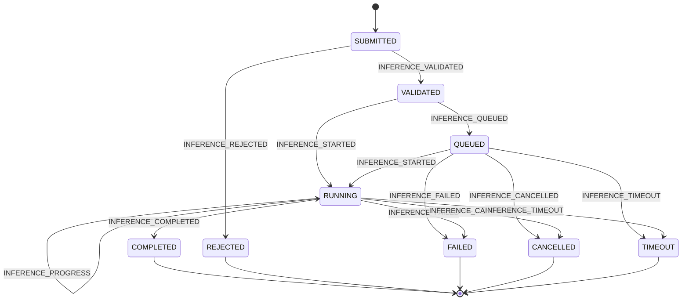

# GIAR-ORION — Technical Design

## DES-M20 — Technical Design

**Código:** DES-M20  
**Versión:** 0.6  
**Fecha:** 11/11/2026  
**Estado:** STAND-BY — diseño técnico preservado; continuidad suspendida temporalmente  
**Documento funcional de referencia:** REG-001 — GIAR-ORION, Especificación Funcional Maestra v0.5  
**Alcance de esta versión:** DT-01 a DT-04 y ampliación de DT-05 (transiciones, catálogos normativos y validaciones semánticas de solicitudes de inferencia)  
**Ubicación prevista en el repositorio:** `GIAR-ORION/02_DESIGN/M20/`

> **Nota de estado:** este documento consolida decisiones y propuestas de diseño técnico. Las decisiones ARC-001 a ARC-006 indicadas como aprobadas fueron aceptadas expresamente. La aprobación de una decisión o de una especificación funcional no significa que exista una implementación ni que se hayan superado pruebas.

------------------------------------------------------------------------

# Control documental

## Historial de versiones

| Versión | Fecha      | Cambios                                                                                                                                         | Estado                                   |
|:--------|:-----------|:------------------------------------------------------------------------------------------------------------------------------------------------|:-----------------------------------------|
| 0.1 | 11/11/2026 | Primera consolidación del diseño técnico: DT-01 a DT-04; incorporación de ARC-001 a ARC-006. | Borrador técnico |
| 0.3 | 11/11/2026 | Incorporación de DT-05: contrato común de eventos de inferencia, catálogo de diez eventos y payloads individuales acordados. Se mantienen DT-01 a DT-04. | Borrador técnico integrado para revisión |
| 0.4 | 11/11/2026 | Se conserva íntegramente la versión 0.3 y se amplía DT-05 con la matriz aprobada de transiciones, diagrama completo de estados, reglas de terminalidad, concurrencia, cancelación, timeout, errores, invariantes y criterios de aceptación. | Borrador técnico integrado para revisión |
| 0.5 | 11/11/2026 | Se conserva íntegramente la versión 0.4 y se amplía DT-05 con DT05-CAT-001 (catálogos normativos aprobados de task_type, rejection_code y error_code) y las diez reglas aprobadas de validación semántica de solicitudes. Se mantienen como pendientes los esquemas JSON definitivos y las pruebas. | Borrador técnico integrado para revisión |
| 0.6 | 11/11/2026 | Se preserva íntegramente el diseño existente (DT-01 a DT-05 y ARC-001 a ARC-006) y se registra STAND-BY de M20 por priorización de la plataforma general y su interfaz. No se amplía ni implementa M20 en esta etapa. | STAND-BY — continuidad suspendida temporalmente |

## Convenciones de estado

- **APROBADA:** decisión aceptada expresamente.
- **PROPUESTA:** solución planteada que todavía requiere aprobación.
- **PENDIENTE:** definición técnica que debe resolverse.
- **BORRADOR:** contenido sujeto a revisión.
- **NO IMPLEMENTADO:** no debe interpretarse como funcionalidad existente.
- **NO PROBADO:** no existen resultados de pruebas que permitan afirmar conformidad.

## Documentos y decisiones de referencia

- `REG-001-GIAR-ORION_Especificacion_Funcional_Maestra_v0.5.md`.
- ORION CORE — especificación funcional, versión 0.1, incorporada en REG-001.
- M20 — Quality & Validation Engine, especificación funcional, versión 0.2, incorporada en REG-001.
- Decisiones arquitectónicas ARC-001 a ARC-006, registradas en este documento.

## Relación entre diseño funcional y diseño técnico

REG-001 define el comportamiento funcional aprobado. Este documento desarrolla propuestas de arquitectura y contratos técnicos para permitir su implementación.

Los contratos funcionales `C20-001` a `C20-012` y `C20-T01` a `C20-T04` pertenecen a M20. No son API, esquemas JSON ni contratos técnicos de ORION CORE. Su formalización técnica corresponde al desarrollo de DT-11 y no debe confundirse con los contratos generales de este documento.

------------------------------------------------------------------------

# Registro de decisiones arquitectónicas

| Código  | Decisión                                                                                                                     | Estado   |
|:--------|:-----------------------------------------------------------------------------------------------------------------------------|:---------|
| ARC-001 | Simplicidad arquitectónica.                                                                                                  | APROBADA |
| ARC-002 | ORION CORE como aplicación modular inicial; agentes ejecutables como procesos independientes cuando se justifique.           | APROBADA |
| ARC-003 | La comunicación entre agentes especializados pasará inicialmente por el Message Broker de ORION CORE.                        | APROBADA |
| ARC-004 | El Broker comenzará con colas en memoria y persistirá selectivamente los mensajes y operaciones que requieran recuperación.  | APROBADA |
| ARC-005 | JSON será el formato común de intercambio de mensajes.                                                                       | APROBADA |
| ARC-006 | Todos los agentes especializados implementarán un contrato común mínimo, manteniendo libertad sobre su arquitectura interna. | APROBADA |

## ARC-001 — Simplicidad arquitectónica

**Estado: APROBADA**

ORION CORE deberá adoptar la arquitectura técnicamente más sencilla que permita satisfacer los requisitos funcionales, de seguridad, disponibilidad, rendimiento y escalabilidad. Toda incorporación de componentes, servicios, procesos o tecnologías adicionales deberá justificarse mediante una necesidad verificable. Se priorizará la modularidad y la posibilidad de evolución progresiva, evitando complejidad prematura.

**Consecuencias:** - No incorporar microservicios, servidores externos o infraestructura adicional por anticipado. - Evitar componentes que dupliquen responsabilidades existentes. - Justificar las tecnologías y procesos independientes por requisitos verificables. - Medir antes de optimizar o distribuir componentes.

## ARC-002 — Modelo inicial de ejecución

**Estado: APROBADA**

ORION CORE se implementará inicialmente como una aplicación modular, con sus componentes separados lógica y funcionalmente. Los agentes especializados podrán ejecutarse como procesos independientes cuando sus necesidades de aislamiento, disponibilidad, recursos o escalabilidad lo justifiquen.

**Consecuencias:** - La separación lógica de componentes no exige separarlos en procesos. - No todos los agentes deben ejecutarse desde el inicio como procesos independientes. - La arquitectura conservará la posibilidad de distribuir agentes progresivamente.

## ARC-003 — Comunicación inicial entre agentes

**Estado: APROBADA**

Inicialmente, la comunicación entre agentes especializados también pasará por el Message Broker de ORION CORE para mantener trazabilidad y control centralizados.

**Consecuencias:** - Se evita establecer canales punto a punto independientes como mecanismo predeterminado. - ORION CORE puede aplicar las políticas de identidad, permisos y trazabilidad. - Una modalidad directa futura requerirá justificación y definición de controles equivalentes.

## ARC-004 — Colas y persistencia del Broker

**Estado: APROBADA**

El Broker comenzará con colas en memoria y persistirá únicamente los mensajes y operaciones que requieran recuperación.

**Consecuencias:** - No se incorpora inicialmente una infraestructura externa de colas. - La persistencia será selectiva y responderá a requisitos de continuidad, recuperación o auditoría. - La pérdida de mensajes en memoria ante una interrupción deberá contemplarse en el análisis de riesgos y en las reglas de reintento. - Los mensajes críticos deberán persistirse antes de depender de ellos para una operación recuperable.

## ARC-005 — Formato común de mensajes

**Estado: APROBADA**

GIAR-ORION utilizará JSON como formato común de intercambio de mensajes entre ORION CORE, los agentes especializados y los módulos del sistema.

**Alcance:** - JSON define la representación de los mensajes. - JSON no determina el protocolo, el transporte ni la topología de red. - Las estructuras se validarán mediante esquemas técnicos que se definirán posteriormente. - La elección del transporte queda pendiente.

## ARC-006 — Contrato común de agentes

**Estado: APROBADA**

Todos los agentes especializados deberán implementar un contrato común mínimo de identidad, registro, capacidades, comunicación, estados y permisos. Sus arquitecturas internas, modelos, herramientas y mecanismos de memoria podrán ser diferentes.

**Consecuencias:** - Un agente de robótica, uno de investigación y uno de visión artificial podrán utilizar modelos y herramientas diferentes. - Todos deberán cumplir las interfaces mínimas de integración. - ORION CORE no deberá depender de la implementación interna de cada agente. - La conformidad con el contrato común será verificable mediante pruebas.

------------------------------------------------------------------------

# DT-01 — Arquitectura técnica general de ORION CORE

**Estado:** Borrador para revisión  
**Versión:** 0.1

## 1. Objetivo

Definir la arquitectura técnica general de ORION CORE, estableciendo sus componentes, responsabilidades, relaciones internas y mecanismos de interacción con agentes especializados y módulos de GIAR-ORION.

El diseño proporciona una base técnica sencilla, modular, extensible y multiplataforma, evitando incorporar complejidad que no esté justificada por requisitos verificables.

## 2. Alcance

Este documento define: - La arquitectura lógica de ORION CORE. - La organización y responsabilidad de sus componentes. - Las relaciones entre ORION CORE y los agentes especializados. - La comunicación con Model Manager. - La gestión de tareas, estados y eventos. - Los principios generales de seguridad, persistencia y recuperación. - Los criterios generales de despliegue.

No define todavía los esquemas detallados de mensajes, las API definitivas, la implementación interna del Message Broker ni la selección de tecnologías.

## 3. Principios técnicos

1.  **Modularidad:** responsabilidades claramente delimitadas.
2.  **Bajo acoplamiento:** interacción mediante interfaces definidas.
3.  **Responsabilidad única:** evitar duplicar funciones.
4.  **Servicios compartidos:** centralizar servicios comunes cuando resulte conveniente.
5.  **Trazabilidad:** identificar y reconstruir operaciones relevantes.
6.  **Seguridad:** aplicar permisos y autorizaciones antes de operaciones protegidas.
7.  **Resiliencia:** gestionar fallos sin comprometer innecesariamente el funcionamiento general.
8.  **Evolución progresiva:** incorporar capacidades sin rediseñar toda la plataforma.
9.  **Multiplataforma:** contemplar Windows 11 y Ubuntu.
10. **Funcionamiento local:** la operación básica no dependerá obligatoriamente de servicios externos.
11. **Escalabilidad gradual:** conservar la posibilidad de utilizar varias GPU y equipos en red local, sin imponer una arquitectura distribuida desde el inicio.
12. **Medición previa:** justificar cambios de arquitectura con requisitos, métricas o pruebas.

## 4. Modelo arquitectónico

Se adopta una arquitectura modular para ORION CORE. Los componentes estarán separados lógica y funcionalmente, aunque inicialmente podrán ejecutarse dentro de una misma aplicación y proceso.

La separación de componentes en procesos o servicios independientes se realizará cuando exista una necesidad demostrable de aislamiento, disponibilidad, rendimiento, recursos o escalabilidad.

### 4.1. Bloques lógicos

**A. Coordinación central** - Inicialización y cierre. - Registro e identificación de agentes. - Recepción y distribución de solicitudes. - Coordinación de tareas. - Gestión de estados. - Supervisión general.

**B. Comunicación** - Recepción y emisión de mensajes. - Enrutamiento. - Gestión de solicitudes y respuestas. - Identificación y correlación de mensajes. - Gestión de errores de comunicación.

**C. Servicios compartidos** - Comunicación con Model Manager. - Consulta de disponibilidad de modelos. - Solicitud de inferencias. - Gestión de recursos compartidos mediante los módulos responsables.

**D. Seguridad y control** - Identificación de agentes. - Verificación de permisos. - Autorización de operaciones. - Registro de operaciones sensibles.

**E. Persistencia y recuperación** - Registro de eventos. - Persistencia de estados. - Recuperación de sesiones y tareas. - Verificación de integridad.

Estos bloques son agrupaciones lógicas de responsabilidades. No implican crear cinco servicios independientes ni agregar componentes funcionales a los diez ya aprobados.

## 5. Componentes funcionales de ORION CORE

Se conservan los diez componentes definidos en REG-001:

| Código | Componente                              | Responsabilidad principal                                                                   |
|:-------|:----------------------------------------|:--------------------------------------------------------------------------------------------|
| OC-01  | Inicialización y cierre                 | Gestionar el ciclo de vida de ORION CORE y el orden de inicio y cierre.                     |
| OC-02  | Registro e identificación de agentes    | Registrar agentes y administrar sus identidades e información operativa.                    |
| OC-03  | Recepción y distribución de solicitudes | Recibir solicitudes y encaminarlas según especialidad, disponibilidad y condiciones.        |
| OC-04  | Coordinación de tareas                  | Organizar y supervisar tareas, dependencias y colaboración entre agentes.                   |
| OC-05  | Comunicación con Model Manager          | Acceder a los servicios centralizados de modelos e inferencia mediante una interfaz común.  |
| OC-06  | Gestión jerárquica de estados           | Administrar estados de plataforma, agentes y tareas de forma coherente y auditable.         |
| OC-07  | Registro de eventos y errores           | Registrar acontecimientos, incidencias y errores, preservando la auditoría crítica.         |
| OC-08  | Control de permisos                     | Verificar permisos y autorizaciones antes de operaciones protegidas.                        |
| OC-09  | Persistencia                            | Conservar la información necesaria para continuidad y recuperación, verificando integridad. |
| OC-10  | Interfaces con módulos futuros          | Proporcionar interfaces estables para integrar módulos presentes y futuros.                 |

Los bloques lógicos del apartado 4 no constituyen componentes adicionales. La división interna de cada componente se definirá durante el diseño detallado.

## 6. Relación con agentes especializados

ORION CORE coordina la actividad general de los agentes especializados. Cada agente tendrá identidad propia y declarará especialidad, capacidades, versión, herramientas y requisitos operativos.

La arquitectura permitirá: - Registrar agentes disponibles. - Consultar capacidades y estados. - Asignar tareas. - Supervisar la ejecución. - Recibir resultados y errores. - Controlar permisos. - Registrar operaciones relevantes. - Suspender, reanudar o finalizar agentes y tareas según las políticas aplicables.

Los agentes podrán colaborar entre sí. Inicialmente, sus mensajes pasarán por el Message Broker de ORION CORE conforme a ARC-003. ORION conservará autoridad sobre coordinación general, permisos y operaciones que requieran intervención central.

El contrato común de agente se desarrolla en DT-04.

## 7. Relación con Model Manager

ORION CORE no administrará directamente la infraestructura interna de los modelos de inteligencia artificial. La comunicación se realizará mediante Model Manager.

Model Manager será responsable de centralizar, según su especificación: - Registro y disponibilidad de modelos. - Administración de instancias de inferencia. - Asignación de recursos. - Recepción de solicitudes de inferencia. - Devolución de resultados. - Información de disponibilidad y errores.

Se evitará cargar múltiples instancias del mismo modelo cuando puedan compartir un servicio de inferencia. Los agentes accederán a los modelos mediante la interfaz autorizada, sin administrar por separado instancias compartidas.

La API específica se desarrollará en DT-05.

## 8. Comunicación interna

Los componentes utilizarán interfaces desacopladas. El mecanismo de comunicación deberá permitir: - Comunicación entre componentes de ORION CORE. - Comunicación entre ORION CORE y agentes. - Comunicación entre agentes mediante el Broker. - Comunicación con Model Manager. - Comunicación con otros módulos.

Se admitirán modalidades síncronas y asíncronas según la naturaleza de cada operación. La tecnología de transporte no se selecciona en esta versión.

La especificación del Message Broker se desarrolla en DT-02; las estructuras comunes se desarrollan en DT-03.

## 9. Seguridad y permisos

La arquitectura deberá garantizar que: - Cada agente y componente tenga una identidad reconocible. - Las operaciones estén sujetas a permisos. - Las autorizaciones se verifiquen antes de ejecutar operaciones sensibles. - Los componentes no puedan otorgarse permisos a sí mismos. - Las operaciones críticas queden registradas. - Los errores de autorización se traten de manera controlada.

ORION CORE conserva la autoridad transversal sobre permisos y coordinación. La definición técnica detallada corresponde al DT-09.

## 10. Estados y eventos

ORION CORE administrará estados generales de plataforma y permitirá el seguimiento de estados de agentes y tareas. Los cambios relevantes deberán generar eventos registrables.

Se distinguirán, como mínimo: - Estado de plataforma. - Estado de componente o servicio. - Estado de agente. - Estado de tarea. - Estado de sesión.

Las transiciones específicas y sus reglas de consistencia se definirán en los contratos técnicos y en los diseños de los módulos correspondientes. Los estados funcionales propios de M20 no deben confundirse con los estados generales de ORION CORE.

## 11. Persistencia y recuperación

La arquitectura contemplará la conservación de: - Identidades y registros de agentes. - Configuraciones necesarias. - Estados de tareas y sesiones. - Eventos relevantes. - Registros de errores. - Información necesaria para recuperación.

La persistencia deberá permitir verificar integridad y detectar inconsistencias. La recuperación de información histórica no implica recuperar automáticamente permisos o autorizaciones anteriores.

El diseño detallado se desarrollará en DT-08. La persistencia selectiva de mensajes del Broker se rige además por ARC-004.

## 12. Despliegue

La arquitectura deberá poder ejecutarse en Windows 11 y Ubuntu, priorizando tecnologías multiplataforma y de código abierto.

El despliegue inicial será local y sencillo. Se conservará la posibilidad de ejecutar agentes en procesos independientes y, posteriormente, en otros equipos de la red local, cuando los requisitos lo justifiquen.

El procedimiento de instalación y despliegue se desarrollará en DT-10.

## 13. Integración con M20

M20 — Quality & Validation Engine se integrará a GIAR-ORION como módulo especializado. ORION CORE proporcionará los servicios generales que M20 necesite: - Identidad y registro de agentes. - Comunicación. - Coordinación de tareas. - Acceso a Model Manager. - Gestión de permisos. - Estados y eventos. - Persistencia y trazabilidad.

M20 conserva sus responsabilidades específicas de validación, evaluación de calidad, decisión, corrección y gestión de evidencias.

Los contratos `C20-001` a `C20-012` y `C20-T01` a `C20-T04` pertenecen a las interacciones internas de M20. No son contratos generales de ORION CORE.

La especificación técnica de M20 corresponde a DT-11.

## 14. Aspectos pendientes

1.  Estructura interna de paquetes y módulos.
2.  Alcance técnico definitivo del Message Broker.
3.  Protocolo y transporte de comunicación.
4.  Esquemas técnicos de mensajes.
5.  Contrato técnico completo de agentes.
6.  Interfaces técnicas con Model Manager.
7.  Mecanismos de persistencia y almacenamiento.
8.  Autenticación y autorización.
9.  Estrategia multiproceso y distribuida.
10. Requisitos cuantitativos de rendimiento y escalabilidad.

## 15. Criterios de aceptación

DT-01 podrá considerarse consolidado cuando: - La arquitectura lógica esté definida. - Las responsabilidades de los componentes estén delimitadas. - Las relaciones entre ORION CORE, agentes y servicios compartidos estén establecidas. - Las decisiones arquitectónicas estén identificadas y justificadas. - Las dependencias con otros módulos estén documentadas. - No existan contradicciones con REG-001. - Los aspectos pendientes estén identificados y asignados.

------------------------------------------------------------------------

# DT-02 — Especificación técnica del Message Broker

**Estado:** Borrador para revisión  
**Versión:** 0.1

## 1. Objetivo

Definir el diseño técnico del mecanismo de comunicación de GIAR-ORION, responsable de transportar mensajes entre ORION CORE, agentes especializados y módulos del sistema.

El diseño prioriza simplicidad, trazabilidad, confiabilidad y evolución progresiva.

## 2. Alcance

Este documento establece: - Responsabilidades del Message Broker. - Modelo general de comunicación. - Tipos de mensajes. - Enrutamiento. - Identificación y correlación. - Comunicación síncrona y asíncrona. - Gestión de errores y reintentos. - Tratamiento de duplicados. - Seguridad y trazabilidad. - Criterios de persistencia y recuperación.

No selecciona todavía una tecnología concreta ni define la implementación definitiva.

## 3. Responsabilidades del Broker

El Message Broker deberá: 1. Recibir mensajes de componentes autorizados. 2. Identificar emisor y destinatario. 3. Validar la estructura básica del mensaje. 4. Determinar el destino indicado. 5. Entregar el mensaje. 6. Gestionar respuestas y confirmaciones cuando correspondan. 7. Controlar errores de comunicación. 8. Facilitar trazabilidad. 9. Aplicar políticas de reintentos. 10. Permitir detectar mensajes duplicados cuando corresponda.

El Broker no será responsable de: - Decidir qué agente debe resolver una tarea. - Ejecutar inferencias. - Validar la calidad del contenido de una respuesta. - Conceder permisos. - Administrar memoria de agentes. - Resolver conflictos funcionales entre agentes.

Estas responsabilidades corresponden a otros componentes.

## 4. Modelo arquitectónico

### 4.1. Implementación inicial

El Message Broker será inicialmente un componente lógico integrado a ORION CORE. No se requiere de inicio un servidor independiente, clúster de mensajería, infraestructura distribuida ni base de datos exclusiva para mensajes.

Su interfaz deberá permitir una eventual separación en otro proceso sin modificar innecesariamente los contratos de comunicación.

### 4.2. Modalidades de comunicación

- **Interna:** entre componentes de ORION CORE.
- **Con agentes:** entre ORION CORE y agentes especializados.
- **Entre agentes:** entre agentes especializados, pasando inicialmente por el Broker conforme a ARC-003.
- **Con módulos:** intercambio con Model Manager y otros módulos registrados, de acuerdo con sus interfaces.

## 5. Tipos de mensajes

Se contemplan inicialmente estas categorías:

| Tipo       | Descripción                                                   |
|:-----------|:--------------------------------------------------------------|
| `REQUEST`  | Solicitud de ejecución o información.                         |
| `RESPONSE` | Respuesta a una solicitud.                                    |
| `COMMAND`  | Instrucción dirigida a un componente o agente.                |
| `EVENT`    | Notificación de un acontecimiento.                            |
| `STATUS`   | Información sobre el estado de un componente, agente o tarea. |
| `ERROR`    | Notificación de un error.                                     |
| `CONTROL`  | Mensajes de coordinación y administración.                    |

La clasificación y los esquemas definitivos se establecerán en DT-03.

## 6. Identificación de mensajes

Todo mensaje deberá disponer de un identificador único. La estructura común prevista incluye: - `message_id`: identificador único del mensaje. - `correlation_id`: identificador que relaciona mensajes de una misma operación. - `sender_id`: identidad del emisor. - `recipient_id`: identidad del destinatario. - `message_type`: tipo de mensaje. - `timestamp`: fecha y hora de creación. - `version`: versión del contrato. - `payload`: contenido específico.

Los formatos definitivos y las reglas de validación se especificarán en DT-03.

## 7. Enrutamiento

El Broker determinará el destino utilizando la identificación del destinatario. Los destinos podrán ser: - Un componente de ORION CORE. - Un agente especializado. - Model Manager. - Otro módulo registrado. - Un conjunto de destinatarios autorizados, cuando corresponda.

El Broker no seleccionará agentes según especialidad, prioridad o disponibilidad. Esa decisión corresponde al componente de coordinación de tareas.

## 8. Comunicación síncrona y asíncrona

Se admitirán ambas modalidades.

### 8.1. Síncrona

Se utilizará cuando el emisor necesite una respuesta antes de continuar. Deberá contemplar tiempo máximo de espera, respuesta satisfactoria, respuesta de error y expiración.

### 8.2. Asíncrona

Se utilizará cuando el emisor pueda continuar sin esperar una respuesta inmediata. Deberá contemplar recepción, confirmación cuando corresponda, notificación de finalización y seguimiento mediante `correlation_id`.

La modalidad se elegirá según la operación. No se impondrá asincronía a todos los intercambios.

## 9. Colas y procesamiento

Conforme a ARC-004, la implementación inicial utilizará colas en memoria. El Broker deberá gestionar mensajes pendientes de entrega o procesamiento.

La persistencia se aplicará selectivamente a los mensajes y operaciones que requieran recuperación, continuidad o auditoría. La política deberá identificar qué mensajes son críticos y en qué momento deben persistirse.

No se incorpora inicialmente un sistema externo de colas. La pérdida de mensajes no persistidos ante una interrupción deberá tratarse mediante límites explícitos, confirmaciones, reintentos o reconstrucción de la operación, según corresponda.

## 10. Reintentos y errores

Se deberán contemplar: - Destinatario no disponible. - Tiempo de espera agotado. - Error de transmisión. - Mensaje inválido. - Destinatario inexistente. - Rechazo por falta de autorización. - Error durante el procesamiento.

Los reintentos serán controlados y limitados. No se repetirán automáticamente operaciones con efectos secundarios sin verificar previamente que la repetición sea segura.

Los errores definitivos deberán registrarse y notificarse al componente responsable.

## 11. Duplicación e idempotencia

El sistema contemplará que un mensaje pueda recibirse más de una vez.

- Cada mensaje tendrá un identificador único.
- Los componentes podrán reconocer mensajes ya procesados cuando corresponda.
- Las operaciones sensibles deberán protegerse contra ejecuciones duplicadas.
- Los reintentos no deberán producir efectos secundarios no deseados.

No se garantizará entrega exactamente una vez en todos los escenarios. Se priorizará entrega confiable, detección de duplicados e idempotencia en las operaciones que lo requieran.

## 12. Seguridad

El Broker deberá verificar la identidad del emisor mediante mecanismos definidos por Security Core, la existencia del destinatario, la estructura del mensaje y las reglas de comunicación aplicables.

La autorización de una operación protegida corresponderá al sistema de seguridad y permisos; el Broker no podrá conceder permisos ni sustituir esa autoridad.

Los mensajes no autorizados o inválidos deberán rechazarse y registrarse sin exponer información sensible.

## 13. Trazabilidad

Los mensajes deberán poder relacionarse con: - Solicitud original. - Tarea correspondiente. - Agente emisor y destinatario. - Respuesta. - Eventos y errores asociados.

Se utilizarán identificadores de mensaje y correlación para reconstruir el recorrido de una operación. El registro respetará políticas de privacidad, seguridad y retención.

## 14. Persistencia y recuperación

Se distinguirán: - Mensajes temporales en memoria. - Mensajes pendientes. - Mensajes procesados. - Mensajes fallidos. - Registros de auditoría asociados.

La persistencia no deberá duplicar innecesariamente el almacenamiento general de GIAR-ORION. Las reglas de persistencia y recuperación se coordinarán con DT-08.

## 15. Evolución

El Broker deberá permitir: 1. Comenzar integrado a ORION CORE. 2. Atender agentes ejecutados en procesos independientes. 3. Incorporar comunicación entre equipos de una red local. 4. Separarse en un servicio independiente si necesidades verificables lo justifican.

La evolución deberá preservar los contratos de comunicación siempre que sea técnicamente posible.

## 16. Aspectos pendientes

1.  Tecnología de comunicación.
2.  Protocolo de transporte.
3.  Implementación de colas.
4.  Esquemas técnicos definitivos.
5.  Política de reintentos y tiempos máximos.
6.  Política de persistencia selectiva.
7.  Comunicación entre equipos.
8.  Retención de mensajes.
9.  Pruebas de rendimiento, concurrencia y recuperación.

## 17. Criterios de aceptación

DT-02 podrá considerarse consolidado cuando las responsabilidades, modalidades, enrutamiento, identificación, correlación, tratamiento de errores, duplicados, seguridad y trazabilidad estén definidos y sean coherentes con ARC-001 a ARC-005, DT-01 y REG-001.

------------------------------------------------------------------------

# DT-03 — Contratos técnicos de ORION CORE

**Estado:** Borrador para revisión  
**Versión:** 0.1

## 1. Objetivo

Definir los contratos técnicos que regulan la comunicación y la interacción entre componentes de ORION CORE, agentes especializados, Model Manager y módulos del sistema.

Los contratos establecerán estructuras de datos, responsabilidades, condiciones de intercambio, respuestas y mecanismos de control para permitir que los componentes evolucionen sin perder compatibilidad.

## 2. Alcance

Se definen: - Convenciones generales de comunicación. - Estructura común de mensajes. - Contratos de solicitudes, respuestas, comandos y eventos. - Contratos de estados y errores. - Identidad, correlación y trazabilidad. - Permisos y autorización. - Comunicación con agentes y Model Manager. - Versionado y compatibilidad.

No se define la implementación interna de cada componente ni se selecciona una tecnología de transporte.

## 3. Principios

1.  Cada mensaje tendrá una estructura identificable.
2.  Los componentes conocerán solamente las interfaces necesarias.
3.  Los mensajes tendrán identificadores únicos.
4.  Los mensajes relacionados compartirán un identificador de correlación.
5.  Los errores utilizarán estructuras comunes.
6.  Los contratos tendrán versiones.
7.  Las operaciones sensibles requerirán autorización.
8.  Los cambios preservarán compatibilidad cuando sea posible.
9.  No se transmitirán datos innecesarios.
10. Los contratos serán independientes del transporte.

## 4. Formato común

Conforme a ARC-005, JSON será el formato común de representación e intercambio de mensajes. Esta decisión no determina si el transporte será local, HTTP, WebSocket, RPC u otro mecanismo; esa selección queda pendiente.

### 4.1. Campos comunes propuestos

| Campo            | Descripción                                | Obligatorio |
|:-----------------|:-------------------------------------------|:------------|
| `message_id`     | Identificador único del mensaje.           | Sí          |
| `correlation_id` | Identificador de la operación relacionada. | Sí          |
| `sender_id`      | Identidad declarada del emisor.            | Sí          |
| `recipient_id`   | Identidad del destinatario.                | Sí          |
| `message_type`   | Tipo de mensaje.                           | Sí          |
| `timestamp`      | Fecha y hora de creación.                  | Sí          |
| `version`        | Versión del contrato.                      | Sí          |
| `payload`        | Contenido específico del mensaje.          | Sí          |

La obligatoriedad y el formato definitivo de cada campo deberán verificarse al construir los esquemas JSON. Los mensajes de difusión o eventos sin respuesta deberán definir una regla explícita para `recipient_id` y `correlation_id`, evitando valores ambiguos.

### 4.2. Ejemplo conceptual

``` json
{
  "message_id": "msg-000001",
  "correlation_id": "task-000001",
  "sender_id": "orion_core",
  "recipient_id": "agent_research",
  "message_type": "REQUEST",
  "timestamp": "2026-11-11T15:00:00Z",
  "version": "1.0",
  "payload": {
    "operation": "research",
    "parameters": {}
  }
}
```

Este ejemplo ilustra la estructura, no constituye todavía un esquema normativo ni fija el formato definitivo de los identificadores o fechas.

## 5. Contrato de solicitudes (`REQUEST`)

Las solicitudes representan pedidos de ejecución o información dirigidos a un componente o agente. Deberán permitir identificar: - Operación solicitada. - Destinatario. - Contexto necesario. - Parámetros de ejecución. - Prioridad, cuando corresponda. - Tiempo máximo de espera, cuando corresponda.

La solicitud deberá poder relacionarse con su respuesta mediante `correlation_id`.

## 6. Contrato de respuestas (`RESPONSE`)

Las respuestas identificarán la solicitud original, emisor, resultado, datos devueltos, condición de finalización y errores u observaciones.

Se distinguirá entre: - Respuesta satisfactoria. - Respuesta satisfactoria con observaciones. - Respuesta fallida. - Respuesta incompleta. - Respuesta no disponible.

Una respuesta satisfactoria no implica que M20 haya validado el resultado.

## 7. Contrato de comandos (`COMMAND`)

Los comandos representan instrucciones dirigidas a un componente o agente. Ejemplos: iniciar, suspender, reanudar o cancelar una tarea; actualizar un estado; ejecutar una acción autorizada.

Los comandos deberán identificar la operación solicitada y verificar los permisos correspondientes antes de ejecutarse.

## 8. Contrato de eventos (`EVENT`)

Los eventos informarán que ocurrió una situación relevante, por ejemplo: - Agente registrado o disponible. - Agente desconectado. - Tarea iniciada o finalizada. - Error detectado. - Recurso no disponible. - Cambio de estado.

Los eventos no implican necesariamente una solicitud de respuesta.

## 9. Contrato de estados (`STATUS`)

Los componentes podrán informar su estado operativo, incluyendo identidad, estado actual, fecha de actualización, disponibilidad e información complementaria.

Se distinguirán los estados de plataforma, componentes, agentes, tareas, sesiones y servicios compartidos. Los estados específicos deberán respetar REG-001 y los documentos de cada módulo.

## 10. Contrato de errores (`ERROR`)

Se propone la siguiente estructura común:

| Campo            | Descripción                                            |
|:-----------------|:-------------------------------------------------------|
| `error_code`     | Código identificador del error.                        |
| `error_type`     | Categoría del error.                                   |
| `message`        | Descripción breve.                                     |
| `source_id`      | Componente que informa el error.                       |
| `correlation_id` | Operación relacionada.                                 |
| `timestamp`      | Fecha y hora.                                          |
| `recoverable`    | Indica si admite recuperación.                         |
| `details`        | Información técnica complementaria, sujeta a permisos. |

Categorías iniciales: - Comunicación. - Validación. - Autorización. - Ejecución. - Recursos. - Persistencia. - Error interno.

Los mensajes de error no deberán exponer información sensible. El catálogo definitivo de códigos queda pendiente.

## 11. Identidad y trazabilidad

Todo componente participante deberá disponer de una identidad reconocible. Los mensajes permitirán reconstruir quién inició una operación, qué componentes participaron, qué mensajes se intercambiaron, qué resultado se obtuvo y qué errores ocurrieron.

`message_id` identifica el mensaje y `correlation_id` relaciona los mensajes de una operación. La identidad declarada dentro del JSON no sustituye la autenticación del emisor.

## 12. Permisos y autorización

Los contratos deberán proporcionar información suficiente para identificar la operación y verificar si el emisor está autorizado.

Reglas: 1. La capacidad técnica no implica autorización. 2. Los permisos se verifican antes de operaciones protegidas. 3. Los agentes no pueden concederse permisos a sí mismos. 4. El Broker no reemplaza al sistema de seguridad. 5. Las operaciones sensibles deben quedar registradas.

La definición técnica detallada corresponde a DT-09.

## 13. Contrato con Model Manager

ORION CORE y los agentes autorizados accederán a modelos mediante Model Manager. El intercambio deberá contemplar: - Identidad del solicitante. - Identificación del modelo solicitado. - Tipo de operación. - Parámetros de inferencia. - Datos de entrada. - Resultado. - Errores. - Información de consumo y recursos, cuando esté disponible.

Model Manager administrará disponibilidad y ejecución de modelos. Los agentes no deberán administrar directamente instancias compartidas de inferencia. La API específica se desarrollará en DT-05.

## 14. Contratos transversales

Se mantienen los cuatro contratos transversales funcionales de ORION CORE:

| Código     | Contrato                     | Responsabilidad                            |
|:-----------|:-----------------------------|:-------------------------------------------|
| C-CORE-T01 | Identity & Traceability      | Identidad, correlación y trazabilidad.     |
| C-CORE-T02 | Permission & Authorization   | Verificación de permisos y autorizaciones. |
| C-CORE-T03 | State & Event Management     | Gestión de estados y eventos.              |
| C-CORE-T04 | Error & Exception Management | Gestión uniforme de errores y excepciones. |

Estos contratos son transversales; no representan componentes independientes. Sus esquemas técnicos deberán especificarse en el desarrollo posterior.

## 15. Versionado y compatibilidad

Se propone evaluar versionado semántico: - **MAJOR:** cambios incompatibles. - **MINOR:** incorporación compatible de funcionalidades. - **PATCH:** correcciones que no modifican la estructura contractual.

Esta convención es una propuesta técnica y queda pendiente de aprobación. Los componentes deberán validar compatibilidad antes de intercambiar información. Los cambios incompatibles deberán documentarse y contar con un procedimiento de transición.

## 16. Validación de contratos

Antes de procesar un mensaje, el receptor deberá verificar: 1. Presencia de campos obligatorios. 2. Tipo de mensaje reconocido. 3. Versión compatible. 4. Identidad autenticada del emisor. 5. Destinatario válido. 6. Estructura del contenido. 7. Permisos requeridos.

Los mensajes inválidos deberán rechazarse y generar un registro de error.

## 17. Aspectos pendientes

1.  Esquemas JSON definitivos.
2.  Tipos de datos y restricciones.
3.  Catálogo de códigos de error.
4.  Catálogo de operaciones y comandos.
5.  Estructuras específicas por tipo de mensaje.
6.  Mecanismos técnicos de autenticación.
7.  Formatos definitivos de fechas e identificadores.
8.  Herramientas de validación automática.
9.  Convención de versionado y compatibilidad.

## 18. Criterios de aceptación

DT-03 podrá considerarse consolidado cuando exista una estructura común de mensajes, estén definidos los tipos de intercambio, la correlación y trazabilidad, los errores tengan estructura común, los contratos transversales estén especificados y la comunicación con agentes y Model Manager sea coherente con DT-02, DT-04 y REG-001.

------------------------------------------------------------------------

# DT-04 — Contrato técnico de agente especializado

**Estado:** Borrador para revisión  
**Versión:** 0.1

## 1. Objetivo

Definir el contrato técnico que deberán cumplir los agentes especializados para integrarse a GIAR-ORION y operar bajo la coordinación de ORION CORE.

El contrato establece una estructura común de identidad, capacidades, comunicación, estados y permisos, permitiendo incorporar, actualizar o reemplazar agentes sin modificar innecesariamente la arquitectura general.

## 2. Alcance

Este documento define: - Identidad y registro. - Especialidad y capacidades. - Comunicación con ORION CORE y otros agentes. - Acceso a Model Manager. - Gestión de tareas. - Estados y ciclo de vida. - Permisos y seguridad. - Memoria, conocimiento y herramientas. - Registro de actividad, monitoreo y recuperación. - Ejecución, despliegue y versionado.

No define la arquitectura interna de cada agente ni obliga a utilizar un modelo de inteligencia artificial determinado.

## 3. Principios generales

1.  Cada agente tendrá identidad única dentro de GIAR-ORION.
2.  Declarará especialidad y capacidades.
3.  Informará su estado operativo.
4.  Recibirá tareas mediante mecanismos autorizados.
5.  Respetará las políticas de seguridad.
6.  Utilizará Model Manager para acceder a modelos compartidos.
7.  Registrará operaciones relevantes.
8.  Mantendrá delimitadas sus responsabilidades.
9.  Podrá actualizarse o reemplazarse respetando contratos.
10. No asumirá la coordinación general propia de ORION CORE.

## 4. Contrato común mínimo

Conforme a ARC-006, todos los agentes deberán implementar como mínimo:

| Área         | Obligación del agente                                        |
|:-------------|:-------------------------------------------------------------|
| Identidad    | Exponer un identificador estable y datos de identificación.  |
| Registro     | Poder registrarse y actualizar su información operativa.     |
| Capacidades  | Declarar especialidades, capacidades y limitaciones.         |
| Comunicación | Intercambiar mensajes compatibles con DT-02 y DT-03.         |
| Estados      | Informar estados operativos y cambios relevantes.            |
| Permisos     | Respetar permisos y autorizaciones aplicables.               |
| Tareas       | Aceptar, rechazar, ejecutar e informar resultados de tareas. |
| Errores      | Informar fallos mediante estructuras comunes.                |
| Trazabilidad | Relacionar actividad con mensajes y tareas.                  |
| Versionado   | Informar versión y compatibilidad contractual.               |

Este contrato mínimo no obliga a que los agentes compartan el mismo modelo, arquitectura interna, herramientas, memoria o tecnología de ejecución.

## 5. Identidad del agente

Cada agente tendrá una identidad única. La información inicial propuesta es:

| Campo               | Descripción                         |
|:--------------------|:------------------------------------|
| `agent_id`          | Identificador único y estable.      |
| `agent_name`        | Nombre del agente.                  |
| `agent_version`     | Versión de la implementación.       |
| `agent_type`        | Categoría o especialidad principal. |
| `description`       | Descripción de sus funciones.       |
| `registration_date` | Fecha de registro.                  |
| `status`            | Estado operativo.                   |

La actualización de versión no generará una nueva identidad, salvo que se trate de un agente distinto. El formato definitivo del registro se especificará mediante un esquema JSON.

## 6. Registro del agente

Todo agente deberá registrarse en ORION CORE antes de recibir tareas.

El registro permitirá: - Identificar al agente. - Conocer su especialidad y capacidades. - Consultar su versión. - Identificar herramientas disponibles. - Conocer requisitos de recursos. - Verificar compatibilidad. - Determinar permisos aplicables.

ORION CORE aceptará o rechazará el registro según las políticas vigentes. La declaración de capacidades no implica que esas capacidades estén autorizadas.

## 7. Especialidad y capacidades

Cada agente declarará las funciones que puede realizar. La descripción permitirá evaluar su adecuación a una tarea.

Ejemplos de especialidades: - Investigación científica y técnica. - Programación e ingeniería de software. - Aprendizaje por refuerzo. - Robótica. - Simulación. - Visión artificial. - Procesamiento de audio. - Análisis de datos. - Gestión documental. - Validación y verificación.

La lista es ilustrativa y no cerrada. Cada capacidad deberá describir identificador, nombre, descripción, tipo de operación, requisitos y limitaciones conocidas.

## 8. Comunicación

Los agentes utilizarán JSON conforme a ARC-005 y las estructuras comunes de DT-03.

El modelo inicial de comunicación será: 1. Agente emisor → Message Broker. 2. Message Broker → ORION CORE o agente destinatario. 3. Agente destinatario → Message Broker. 4. Message Broker → agente solicitante.

La comunicación entre agentes pasará inicialmente por el Broker. Los mensajes deberán incluir identificadores y campos comunes. El agente no podrá eludir controles de identidad, permisos o trazabilidad.

## 9. Ejecución de tareas

Un agente deberá poder: 1. Recibir una solicitud. 2. Verificar que corresponde a sus capacidades. 3. Comprobar requisitos de ejecución. 4. Verificar permisos. 5. Aceptar o rechazar la tarea. 6. Ejecutar la operación. 7. Informar cambios de estado. 8. Devolver resultados. 9. Comunicar errores u observaciones.

El agente no podrá modificar unilateralmente la asignación de una tarea ni asumir atribuciones de ORION CORE. La suspensión, reanudación o cancelación se regirá por las políticas del sistema.

## 10. Acceso a Model Manager

Los agentes utilizarán Model Manager para acceder a modelos compartidos. Deberán poder solicitar un modelo, informar parámetros, enviar entradas, recibir resultados y comunicar errores o requisitos de recursos.

No deberán crear instancias redundantes de modelos compartidos cuando estén administrados por Model Manager.

Podrá admitirse la utilización de modelos locales propios cuando esté justificada y autorizada. La arquitectura y los modelos internos del agente no quedan uniformados por este contrato.

## 11. Memoria y conocimiento

Cada agente podrá disponer de mecanismos propios de: - Memoria de trabajo. - Memoria de sesión. - Memoria persistente. - Base de conocimiento. - Recuperación RAG.

La gestión será responsabilidad del agente o del módulo especializado correspondiente y respetará las políticas generales de GIAR-ORION.

La información compartida entre agentes estará sujeta a permisos. La memoria de un agente no se confundirá con el registro central de eventos ni con la persistencia de ORION CORE.

## 12. Herramientas

Cada agente podrá disponer de herramientas específicas, por ejemplo: - Intérpretes y entornos de ejecución. - Herramientas de análisis de código. - Simuladores. - Sistemas de visión artificial. - Sistemas de procesamiento de audio. - Herramientas de investigación. - Acceso a archivos y documentos.

El agente declarará las herramientas disponibles y sus requisitos. La disponibilidad de una herramienta no implica autorización para utilizarla. Las operaciones que modifiquen archivos, ejecuten código o interactúen con sistemas externos respetarán las políticas de seguridad.

## 13. Estados del agente

Se propone el siguiente conjunto inicial de estados operativos:

| Estado         | Descripción                       |
|:---------------|:----------------------------------|
| `REGISTERED`   | Agente registrado.                |
| `INITIALIZING` | Preparando su entorno.            |
| `READY`        | Disponible para recibir tareas.   |
| `BUSY`         | Ejecutando una tarea.             |
| `WAITING`      | Esperando recursos o información. |
| `SUSPENDED`    | Ejecución suspendida.             |
| `ERROR`        | Presenta un error operativo.      |
| `OFFLINE`      | No se encuentra disponible.       |
| `TERMINATING`  | Finalizando su ejecución.         |
| `TERMINATED`   | Ejecución finalizada.             |

Este catálogo es una propuesta técnica inicial. Las transiciones permitidas, estados adicionales y condiciones deberán validarse contra el modelo jerárquico de REG-001 y las pruebas de integración.

## 14. Ciclo de vida

El ciclo de vida general comprenderá: 1. Creación o incorporación. 2. Registro. 3. Validación de identidad y capacidades. 4. Inicialización. 5. Disponibilidad. 6. Asignación de tareas. 7. Ejecución. 8. Suspensión o recuperación, cuando corresponda. 9. Finalización. 10. Desactivación o eliminación del registro según las políticas aplicables.

ORION CORE deberá poder conocer la situación operativa del agente.

## 15. Permisos y seguridad

Los agentes operarán bajo permisos explícitamente autorizados. Se contemplan permisos relacionados con: - Comunicación. - Acceso a archivos. - Acceso a conocimiento. - Utilización de modelos. - Ejecución de herramientas. - Modificación de información. - Acceso a otros agentes. - Operaciones administrativas.

Reglas: 1. Un agente no podrá concederse permisos a sí mismo. 2. Las capacidades declaradas no implican autorización. 3. Los permisos se verificarán antes de operaciones protegidas. 4. Las operaciones sensibles quedarán registradas. 5. Se respetarán restricciones de acceso a información.

ORION CORE conservará la autoridad transversal sobre coordinación y permisos. La definición técnica detallada corresponde a DT-09.

## 16. Registro de actividad

Cada agente proporcionará información suficiente para reconstruir sus operaciones relevantes. Se registrarán, según corresponda: - Inicio y finalización de tareas. - Solicitudes recibidas. - Respuestas emitidas. - Cambios de estado. - Utilización de herramientas. - Solicitudes a Model Manager. - Errores. - Operaciones sensibles.

Los registros se relacionarán con identificadores de mensaje y tarea. Su detalle y retención respetarán las políticas del sistema.

## 17. Monitoreo y recuperación

ORION CORE deberá poder conocer la disponibilidad de los agentes. Se contemplan mecanismos para: - Consultar estados. - Detectar falta de respuesta. - Identificar errores e interrupciones. - Solicitar suspensión o finalización. - Recuperar tareas cuando corresponda. - Reasignar tareas a otros agentes si está permitido.

La recuperación deberá considerar si repetir una tarea es seguro y si sus efectos secundarios pueden evitarse. No se deberá declarar recuperada una operación sin verificar su estado.

## 18. Ejecución y despliegue

Los agentes podrán ejecutarse: - Dentro del mismo proceso de ORION CORE cuando resulte apropiado. - Como procesos independientes. - En otros equipos de la red local cuando la arquitectura y la seguridad lo permitan.

La modalidad dependerá de requisitos de recursos, aislamiento, disponibilidad y escalabilidad. No se exigirá que todos los agentes utilicen la misma tecnología o modelo.

## 19. Versionado y compatibilidad

Cada agente informará su versión. Los cambios deberán contemplar: - Compatibilidad con contratos vigentes. - Identificación de cambios incompatibles. - Actualización de capacidades declaradas. - Compatibilidad con versiones de GIAR-ORION. - Posibilidad de reemplazo o reversión.

Una actualización no modificará silenciosamente los contratos de comunicación. La convención técnica de versionado queda pendiente de consolidación en DT-03.

## 20. Aspectos pendientes

1.  Esquema JSON definitivo del registro.
2.  Esquema JSON de declaración de capacidades.
3.  Estructura de solicitudes y respuestas de tareas.
4.  Catálogo definitivo de estados y transiciones.
5.  Mecanismo de identificación y autenticación.
6.  Modelo detallado de permisos.
7.  Interfaz de monitoreo.
8.  Política de recuperación de tareas.
9.  Requisitos de compatibilidad entre versiones.
10. Pruebas de conformidad de agentes.

## 21. Criterios de aceptación

DT-04 podrá considerarse consolidado cuando: - La identidad de los agentes esté definida. - El registro tenga una estructura común. - Las capacidades puedan declararse y verificarse. - La comunicación respete DT-02 y DT-03. - La interacción con Model Manager esté definida. - Los estados y el ciclo de vida sean consistentes. - Los permisos estén delimitados. - Existan mecanismos de monitoreo y recuperación. - Se pueda incorporar un nuevo agente sin modificar innecesariamente ORION CORE. - No existan contradicciones con REG-001.

------------------------------------------------------------------------


# DT-05 — API técnica de Model Manager

**Estado:** Borrador técnico integrado; catálogo y criterios de eventos aprobados durante la definición.  
**Versión:** 0.5  
**Alcance:** contrato de eventos del ciclo de vida de inferencias, catálogos normativos y validaciones semánticas.  
**Responsable de emisión de eventos:** Model Manager.

## 1. Objetivo

Definir el contrato técnico de eventos mediante el cual Model Manager informa a ORION CORE y a los agentes autorizados sobre el ciclo de vida de las solicitudes de inferencia, manteniendo independencia respecto del proveedor de modelos utilizado.

El diseño establece un sobre común (`ENVELOPE`), un catálogo inicial de diez eventos y la estructura de datos específica (`PAYLOAD`) de cada evento.

## 2. Alcance y límites

DT-05 define en esta versión:

- El contrato común de los eventos de inferencia.
- Los diez eventos iniciales y sus condiciones generales de emisión.
- Los campos de los payloads, su obligatoriedad y sus reglas básicas.
- La responsabilidad de Model Manager como emisor de estos eventos.
- Las reglas generales de secuencia, estados, terminalidad y trazabilidad.

DT-05 no selecciona todavía el protocolo de transporte, el mecanismo de publicación/suscripción, la tecnología de cola, el almacenamiento de resultados ni el proveedor de inferencia. Tampoco define la API completa de administración de modelos, carga/descarga de instancias o asignación de recursos. Esos aspectos deberán desarrollarse en las secciones técnicas correspondientes.

## 3. Decisiones aprobadas

| Código | Decisión | Estado |
|:--|:--|:--|
| DT05-DEC-001 | Model Manager abstrae a los proveedores de inferencia. Los consumidores no deben depender de la API particular de Ollama u otro proveedor. | APROBADA |
| DT05-DEC-002 | Model Manager es el emisor de los diez eventos del ciclo de vida definidos en este DT. Puede recibir datos originados en el proveedor, pero los normaliza y emite bajo el contrato GIAR-ORION. | APROBADA |
| DT05-DEC-003 | Todos los eventos utilizan una estructura común `ENVELOPE + PAYLOAD`. | APROBADA |
| DT05-DEC-004 | Se adopta el catálogo inicial de diez eventos indicado en el apartado 5. | APROBADA |
| DT05-DEC-005 | El evento `INFERENCE_SUBMITTED` utiliza `input` como estructura multimodal extensible desde esta versión. | APROBADA |

La aprobación de estas decisiones y de las estructuras aquí documentadas no implica que la API esté implementada ni que haya superado pruebas de conformidad.

**Límite de aprobación:** quedaron aprobados el envelope común, el catálogo de diez eventos, la emisión lógica por Model Manager y los campos funcionales acordados para cada payload. Los tipos de datos, obligatoriedad detallada, rangos, enumeraciones, ejemplos JSON, reglas de transición y restricciones adicionales que se formalizan en esta versión constituyen la especificación técnica propuesta para revisión. No deben interpretarse como decisiones aprobadas individualmente cuando no fueron validadas expresamente.

## 4. Contrato común de eventos — ENVELOPE

Todos los eventos definidos en DT-05 DEBEN utilizar el siguiente sobre común:

```json
{
  "event_id": "evt-000001",
  "event_type": "INFERENCE_SUBMITTED",
  "event_version": "1.0",
  "request_id": "req-000001",
  "correlation_id": "task-000001",
  "sequence_number": 1,
  "timestamp": "2026-11-11T19:23:00Z",
  "payload": {}
}
```

### 4.1. Definición de campos

| Campo | Tipo | Obligatorio | Regla |
|:--|:--|:--:|:--|
| `event_id` | string | Sí | Identificador único del evento. No se reutiliza. |
| `event_type` | string | Sí | Uno de los diez valores del catálogo DT-05. |
| `event_version` | string | Sí | Versión del esquema del evento. En esta edición inicial: `1.0`. |
| `request_id` | string | Sí | Identificador estable de la solicitud de inferencia durante todo su ciclo de vida. |
| `correlation_id` | string | Sí | Identificador que relaciona la solicitud con la tarea o proceso de origen. |
| `sequence_number` | integer | Sí | Número secuencial creciente dentro de una misma solicitud, comenzando en 1. |
| `timestamp` | string, date-time | Sí | Instante de emisión del evento en UTC, expresado en RFC 3339/ISO 8601 y terminado en `Z`. |
| `payload` | object | Sí | Datos específicos del evento. Su esquema depende de `event_type`. |

### 4.2. Reglas del envelope

1. Cada evento tiene un `event_id` propio.
2. Todos los eventos de una misma solicitud conservan el mismo `request_id` y `correlation_id`.
3. `sequence_number` aumenta estrictamente para cada nuevo evento de esa solicitud. No se reutilizan números.
4. `timestamp` representa el instante en que Model Manager emite el evento, no necesariamente el instante en que comenzó la operación subyacente.
5. Los campos temporales específicos que se mantengan dentro de un payload deberán representar el instante funcional correspondiente y ser coherentes con el `timestamp` del envelope.
6. El receptor no debe inferir el orden exclusivamente a partir de `timestamp`; debe utilizar `sequence_number` dentro de cada `request_id`.
7. `payload` debe ser un objeto JSON. No se admiten valores nulos ni estructuras arbitrarias en su lugar.
8. Los eventos de una solicitud deben ser compatibles con el mismo `event_version`, salvo que se documente explícitamente una transición de versión.

## 5. Catálogo aprobado de eventos

| ID | `event_type` | Finalidad | Terminal |
|:--|:--|:--|:--:|
| EVT-001 | `INFERENCE_SUBMITTED` | Model Manager recibió una solicitud de inferencia. | No |
| EVT-002 | `INFERENCE_VALIDATED` | La solicitud superó las validaciones iniciales. | No |
| EVT-003 | `INFERENCE_REJECTED` | La solicitud fue rechazada y no será procesada. | Sí |
| EVT-004 | `INFERENCE_QUEUED` | La solicitud validada ingresó en una cola de ejecución. | No |
| EVT-005 | `INFERENCE_STARTED` | Comenzó la ejecución de la inferencia. | No |
| EVT-006 | `INFERENCE_PROGRESS` | Se comunicó un avance de la ejecución. | No |
| EVT-007 | `INFERENCE_COMPLETED` | La inferencia finalizó correctamente. | Sí |
| EVT-008 | `INFERENCE_FAILED` | La inferencia finalizó con un error. | Sí |
| EVT-009 | `INFERENCE_CANCELLED` | La cancelación fue aplicada y confirmada. | Sí |
| EVT-010 | `INFERENCE_TIMEOUT` | Se alcanzó el límite temporal permitido. | Sí |

Un evento terminal cierra el ciclo de procesamiento de la solicitud. Una solicitud no puede tener más de un resultado terminal válido. Los eventos posteriores de la misma solicitud solo podrán ser eventos administrativos o de auditoría definidos fuera de este catálogo; no podrán reabrir implícitamente la inferencia.

## 6. Payloads individuales

En las tablas siguientes, “obligatorio” significa que el campo debe estar presente en el payload cuando se emite ese evento. Los campos opcionales pueden omitirse cuando el dato no exista o el proveedor no lo proporcione; no deben completarse con valores inventados.

### 6.1. EVT-001 — `INFERENCE_SUBMITTED`

**Finalidad:** registrar la recepción de una solicitud de inferencia.

**Emisor:** Model Manager.  
**Condición:** Model Manager recibe una solicitud y puede identificarla para iniciar su validación.  
**Estado resultante:** `SUBMITTED`.

| Campo | Tipo | Obligatorio | Descripción y regla |
|:--|:--|:--:|:--|
| `model_id` | string | Sí | Identificador lógico del modelo solicitado; no debe exponer el identificador interno del proveedor. |
| `task_type` | string | Sí | Tipo de tarea solicitada, según el catálogo de tareas que se formalizará para Model Manager. |
| `input` | object | Sí | Entrada multimodal extensible. Debe contener al menos una representación de entrada o referencia a ella. |
| `priority` | integer | Sí | Prioridad de 1 a 5. Valor por defecto: 3 cuando el solicitante no indique prioridad. |
| `requested_by` | string | Sí | Identidad del agente o componente solicitante. |
| `request_metadata` | object | No | Metadatos adicionales no necesarios para interpretar la operación. |

#### Estructura multimodal de `input`

`input` se define como objeto extensible para admitir texto, imágenes, audio, video y otros tipos de entrada sin modificar el envelope. La representación concreta deberá identificar la modalidad y contener el dato o una referencia recuperable.

Ejemplo conceptual:

```json
{
  "modality": "multimodal",
  "items": [
    {
      "type": "text",
      "content": "Analizar la siguiente escena."
    },
    {
      "type": "image",
      "reference": "input://images/scene-0001"
    },
    {
      "type": "audio",
      "reference": "input://audio/sample-0001",
      "metadata": {
        "format": "wav"
      }
    }
  ],
  "metadata": {}
}
```

Reglas:

- `input.items` debe contener al menos un elemento.
- Cada elemento debe declarar `type`.
- El elemento puede transportar `content` o una `reference` válida; no se exige incluir archivos binarios directamente en el evento.
- `metadata` es opcional y puede describir formato, dimensiones, duración, codificación u otras propiedades pertinentes.
- La lista de modalidades y los esquemas detallados por modalidad quedan sujetos a evolución compatible.
- Las referencias deben ser resolubles por Model Manager y estar sometidas a los controles de acceso correspondientes.

Ejemplo de payload:

```json
{
  "model_id": "orion.general",
  "task_type": "TEXT_GENERATION",
  "input": {
    "modality": "text",
    "items": [
      {
        "type": "text",
        "content": "Explicar el resultado del experimento."
      }
    ]
  },
  "priority": 3,
  "requested_by": "agent_research",
  "request_metadata": {
    "source": "research_task"
  }
}
```

### 6.2. EVT-002 — `INFERENCE_VALIDATED`

**Finalidad:** informar que la solicitud superó las validaciones iniciales.  
**Condición:** todos los controles de admisión definidos para la solicitud resultan satisfactorios.  
**Estado resultante:** `VALIDATED`.

| Campo | Tipo | Obligatorio | Descripción y regla |
|:--|:--|:--:|:--|
| `validation_id` | string | Sí | Identificador único del proceso o registro de validación. |
| `validated_model_id` | string | Sí | Identificador lógico del modelo cuya compatibilidad fue validada. |
| `validation_timestamp` | string, date-time | Sí | Instante de finalización de la validación en UTC. Debe ser coherente con el `timestamp` del envelope. |
| `validation_details` | object | Sí | Resultado estructurado de las comprobaciones realizadas. Debe permitir conocer qué controles se ejecutaron y su resultado. |

La validación no significa que la inferencia haya comenzado ni garantiza que el proveedor permanezca disponible posteriormente.

Ejemplo:

```json
{
  "validation_id": "val-000001",
  "validated_model_id": "orion.general",
  "validation_timestamp": "2026-11-11T19:23:01Z",
  "validation_details": {
    "valid": true,
    "checks": [
      {"name": "model_available", "passed": true},
      {"name": "task_supported", "passed": true},
      {"name": "input_accepted", "passed": true}
    ]
  }
}
```

### 6.3. EVT-003 — `INFERENCE_REJECTED`

**Finalidad:** informar que una solicitud no puede ser admitida para procesamiento.  
**Condición:** falla una condición obligatoria de admisión o validación.  
**Estado resultante:** `REJECTED`.  
**Terminal:** sí.

| Campo | Tipo | Obligatorio | Descripción y regla |
|:--|:--|:--:|:--|
| `rejection_code` | string | Sí | Código estable que identifica la causa del rechazo. |
| `rejection_reason` | string | Sí | Explicación breve y comprensible del rechazo. |
| `rejected_field` | string | No | Campo de la solicitud que originó el rechazo, cuando pueda identificarse. |
| `possible_recoverability` | boolean | Sí | Indica si el solicitante podría corregir la causa y enviar una nueva solicitud. |

`possible_recoverability` no autoriza a reabrir la solicitud rechazada. Una corrección deberá originar una nueva solicitud con un nuevo `request_id`.

Ejemplo:

```json
{
  "rejection_code": "UNSUPPORTED_TASK",
  "rejection_reason": "El modelo lógico solicitado no admite el tipo de tarea indicado.",
  "rejected_field": "task_type",
  "possible_recoverability": true
}
```

### 6.4. EVT-004 — `INFERENCE_QUEUED`

**Finalidad:** informar que una solicitud validada ingresó en una cola de ejecución.  
**Condición:** la ejecución no comienza inmediatamente y la solicitud queda esperando recursos o turno.  
**Estado resultante:** `QUEUED`.

| Campo | Tipo | Obligatorio | Descripción y regla |
|:--|:--|:--:|:--|
| `queue_id` | string | Sí | Identificador de la cola lógica o de planificación. |
| `queue_position` | integer | No | Posición estimada de la solicitud en la cola, si el planificador puede determinarla. Debe ser mayor o igual que 1. |
| `estimated_wait_time` | number | No | Tiempo de espera estimado, expresado en segundos y mayor o igual que cero. Es una estimación, no una garantía. |

El instante de ingreso a la cola queda registrado en `timestamp` del envelope. No se duplica mediante un campo `queued_at` en el payload.

Ejemplo:

```json
{
  "queue_id": "inference-default",
  "queue_position": 2,
  "estimated_wait_time": 8.5
}
```

### 6.5. EVT-005 — `INFERENCE_STARTED`

**Finalidad:** informar que comenzó el procesamiento efectivo de la inferencia.  
**Condición:** Model Manager confirma el inicio de la ejecución en una instancia de inferencia.  
**Estado resultante:** `RUNNING`.

| Campo | Tipo | Obligatorio | Descripción y regla |
|:--|:--|:--:|:--|
| `provider_id` | string | Sí | Identificador normalizado del proveedor que ejecuta la inferencia. |
| `instance_id` | string | Sí | Identificador de la instancia de ejecución asignada. |
| `model_version` | string | No | Versión concreta del modelo, si el proveedor la informa. |

El instante de inicio se registra en el campo `timestamp` del envelope, que cumple la función de `started_at`. No se agrega otro campo temporal redundante al payload.

Ejemplo:

```json
{
  "provider_id": "ollama",
  "instance_id": "ollama-local-01",
  "model_version": "8b"
}
```

### 6.6. EVT-006 — `INFERENCE_PROGRESS`

**Finalidad:** comunicar un avance durante una inferencia en ejecución.  
**Condición:** Model Manager recibe información de progreso confiable y útil desde el proveedor o desde el mecanismo de ejecución.  
**Estado resultante:** `RUNNING`.  
**Emisión:** opcional y repetible.

| Campo | Tipo | Obligatorio | Descripción y regla |
|:--|:--|:--:|:--|
| `percentage` | number | No | Porcentaje de avance entre 0 y 100, cuando pueda calcularse de forma válida. |
| `stage` | string | No | Etapa de procesamiento informada. |
| `message` | string | No | Descripción breve del avance. |

Debe existir al menos uno de los campos `percentage`, `stage` o `message`. El `timestamp` del envelope indica cuándo se emitió la actualización.

No se debe inventar un porcentaje cuando el proveedor no ofrece una métrica de progreso. En ese caso, Model Manager podrá informar una etapa o mensaje, si dispone de información útil, o no emitir este evento.

Ejemplo:

```json
{
  "percentage": 45,
  "stage": "GENERATING",
  "message": "Se está generando la respuesta."
}
```

### 6.7. EVT-007 — `INFERENCE_COMPLETED`

**Finalidad:** informar que la inferencia terminó correctamente y que el resultado puede recuperarse.  
**Condición:** Model Manager recibió y verificó que existe un resultado final utilizable.  
**Estado resultante:** `COMPLETED`.  
**Terminal:** sí.

| Campo | Tipo | Obligatorio | Descripción y regla |
|:--|:--|:--:|:--|
| `result_reference` | string | Sí | Identificador o URI lógica para recuperar el resultado. |
| `output_type` | string | Sí | Tipo de resultado: texto, imagen, audio, video, datos estructurados u otro tipo admitido. |
| `output_size` | integer | No | Tamaño del resultado en bytes, cuando sea medible. Debe ser mayor o igual que cero. |
| `output_metadata` | object | No | Metadatos descriptivos del resultado, por ejemplo formato, codificación, dimensiones o duración. |

El resultado completo no debe incorporarse al evento cuando su tamaño o naturaleza hagan inconveniente su transporte dentro del mensaje. Se utilizará `result_reference`. El instante de finalización se registra en el `timestamp` del envelope.

Ejemplo:

```json
{
  "result_reference": "result://req-000001/output-000001",
  "output_type": "text",
  "output_size": 1842,
  "output_metadata": {
    "format": "text/plain",
    "encoding": "utf-8"
  }
}
```

### 6.8. EVT-008 — `INFERENCE_FAILED`

**Finalidad:** informar que la inferencia no pudo completarse debido a un error.  
**Condición:** la ejecución falla y Model Manager determina que no existe un resultado final satisfactorio para esa solicitud.  
**Estado resultante:** `FAILED`.  
**Terminal:** sí.

| Campo | Tipo | Obligatorio | Descripción y regla |
|:--|:--|:--:|:--|
| `error_code` | string | Sí | Código estable que identifica el tipo de error. |
| `error_message` | string | Sí | Descripción breve del error, sin credenciales ni información sensible. |
| `possible_recoverability` | boolean | Sí | Indica si una nueva tentativa podría resolver la causa. |

El instante del error se registra en el `timestamp` del envelope. Los detalles técnicos ampliados, trazas y datos internos del proveedor deberán quedar en registros protegidos y solo se expondrán mediante mecanismos autorizados.

Ejemplo:

```json
{
  "error_code": "PROVIDER_UNAVAILABLE",
  "error_message": "El proveedor dejó de estar disponible durante la ejecución.",
  "possible_recoverability": true
}
```

### 6.9. EVT-009 — `INFERENCE_CANCELLED`

**Finalidad:** informar que una solicitud fue cancelada y que Model Manager confirmó que dejó de procesarse.  
**Condición:** la cancelación fue aplicada, ya sea sobre una solicitud en cola o en ejecución.  
**Estado resultante:** `CANCELLED`.  
**Terminal:** sí.

| Campo | Tipo | Obligatorio | Descripción y regla |
|:--|:--|:--:|:--|
| `cancellation_stage` | string | Sí | Etapa en la que se aplicó la cancelación: `QUEUED` o `RUNNING`. |
| `requested_by` | string | No | Identidad del agente o componente que solicitó la cancelación, si se conoce. |
| `cancelled_at` | string, date-time | Sí | Instante en que la cancelación quedó efectivamente aplicada. Debe ser coherente con el `timestamp` del envelope. |

No debe emitirse `INFERENCE_CANCELLED` por el solo hecho de recibir una petición de cancelación. Si la cancelación no puede aplicarse, deberá informarse mediante el mecanismo de respuesta/error correspondiente, sin declarar terminal la solicitud.

Ejemplo:

```json
{
  "cancellation_stage": "RUNNING",
  "requested_by": "agent_research",
  "cancelled_at": "2026-11-11T19:24:10Z"
}
```

### 6.10. EVT-010 — `INFERENCE_TIMEOUT`

**Finalidad:** informar que se alcanzó el límite temporal configurado para una solicitud.  
**Condición:** vence el límite aplicable y Model Manager determina que la solicitud no puede continuar bajo ese plazo.  
**Estado resultante:** `TIMEOUT`.  
**Terminal:** sí.

| Campo | Tipo | Obligatorio | Descripción y regla |
|:--|:--|:--:|:--|
| `timeout_threshold` | number | Sí | Límite temporal configurado, expresado en segundos y mayor que cero. |
| `elapsed_time` | number | Sí | Tiempo transcurrido hasta declarar el timeout, expresado en segundos y mayor o igual que cero. |
| `execution_stage` | string | Sí | Etapa en que venció el límite: `QUEUED` o `RUNNING`. |

El instante en que se declara el timeout queda registrado en el `timestamp` del envelope.

Ejemplo:

```json
{
  "timeout_threshold": 120,
  "elapsed_time": 120.4,
  "execution_stage": "RUNNING"
}
```

## 7. Estados y transiciones

Los eventos representan hechos; el estado de la solicitud se deriva de la secuencia de eventos válidos. No se agrega un campo `current_state` al envelope, para evitar contradicciones entre el tipo de evento y un estado duplicado.

| Estado | Evento que lo establece | Naturaleza |
|:--|:--|:--|
| `SUBMITTED` | `INFERENCE_SUBMITTED` | No terminal |
| `VALIDATED` | `INFERENCE_VALIDATED` | No terminal |
| `QUEUED` | `INFERENCE_QUEUED` | No terminal |
| `RUNNING` | `INFERENCE_STARTED` | No terminal |
| `COMPLETED` | `INFERENCE_COMPLETED` | Terminal |
| `REJECTED` | `INFERENCE_REJECTED` | Terminal |
| `FAILED` | `INFERENCE_FAILED` | Terminal |
| `CANCELLED` | `INFERENCE_CANCELLED` | Terminal |
| `TIMEOUT` | `INFERENCE_TIMEOUT` | Terminal |

### 7.1. Transiciones válidas iniciales

```text
SUBMITTED
   |
   +----> REJECTED
   |
   v
VALIDATED
   |
   +----> QUEUED ----+
   |                |
   +----------------+----> RUNNING
                              |
                              +----> PROGRESS (permanece RUNNING)
                              |
                              +----> COMPLETED
                              +----> FAILED
                              +----> CANCELLED
                              +----> TIMEOUT

Desde QUEUED también puede producirse CANCELLED o TIMEOUT.
```

Reglas:

1. `INFERENCE_SUBMITTED` inicia la secuencia y utiliza `sequence_number = 1`.
2. Una solicitud aceptada debe generar `INFERENCE_VALIDATED` antes de `INFERENCE_QUEUED` o `INFERENCE_STARTED`.
3. `INFERENCE_QUEUED` es opcional: una solicitud puede pasar de `VALIDATED` directamente a `RUNNING`.
4. `INFERENCE_PROGRESS` solo puede emitirse mientras la solicitud esté en `RUNNING`.
5. `INFERENCE_REJECTED` solo puede cerrar una solicitud que todavía no haya iniciado su ejecución.
6. `INFERENCE_CANCELLED` puede cerrar una solicitud en `QUEUED` o `RUNNING`, una vez aplicada la cancelación.
7. `INFERENCE_TIMEOUT` puede cerrar una solicitud en `QUEUED` o `RUNNING`, según el límite que haya vencido.
8. `COMPLETED`, `REJECTED`, `FAILED`, `CANCELLED` y `TIMEOUT` son resultados terminales mutuamente excluyentes.
9. No se admitirán eventos de progreso ni de ejecución posteriores a un evento terminal para el mismo `request_id`.

### 7.2. Matriz normativa de transiciones aprobadas

La siguiente matriz establece las transiciones permitidas para el ciclo de vida de una solicitud de inferencia. Toda transición no incluida expresamente se considera inválida.

| Estado de origen | Estado de destino permitido | Evento que confirma la transición | Condición |
|:--|:--|:--|:--|
| `SUBMITTED` | `VALIDATED` | `INFERENCE_VALIDATED` | La solicitud supera las validaciones de admisión. |
| `SUBMITTED` | `REJECTED` | `INFERENCE_REJECTED` | La solicitud no supera una condición obligatoria de admisión. |
| `VALIDATED` | `QUEUED` | `INFERENCE_QUEUED` | La solicitud validada debe esperar turno o recursos. |
| `VALIDATED` | `RUNNING` | `INFERENCE_STARTED` | La ejecución comienza sin pasar por una cola de espera observable. |
| `QUEUED` | `RUNNING` | `INFERENCE_STARTED` | Se asignan recursos y comienza la ejecución. |
| `QUEUED` | `CANCELLED` | `INFERENCE_CANCELLED` | La solicitud se retira de la cola y la cancelación queda aplicada. |
| `QUEUED` | `TIMEOUT` | `INFERENCE_TIMEOUT` | Vence el límite temporal aplicable mientras la solicitud espera en cola. |
| `QUEUED` | `FAILED` | `INFERENCE_FAILED` | Se produce un fallo que impide continuar con la solicitud en cola. |
| `RUNNING` | `COMPLETED` | `INFERENCE_COMPLETED` | Existe un resultado final utilizable y verificable. |
| `RUNNING` | `FAILED` | `INFERENCE_FAILED` | La ejecución termina por un error sin resultado satisfactorio. |
| `RUNNING` | `CANCELLED` | `INFERENCE_CANCELLED` | La ejecución se ha detenido efectivamente por cancelación. |
| `RUNNING` | `TIMEOUT` | `INFERENCE_TIMEOUT` | Vence el límite temporal y la ejecución deja de continuar bajo esa solicitud. |

Los estados `COMPLETED`, `REJECTED`, `FAILED`, `CANCELLED` y `TIMEOUT` son terminales. No admiten transiciones ordinarias de salida ni reapertura de la solicitud.

`INFERENCE_PROGRESS` no representa una transición de estado: se emite durante `RUNNING` y la solicitud permanece en ese estado.

### 7.3. Diagrama completo de estados

El siguiente diagrama representa las transiciones aprobadas. Las flechas hacia estados terminales son definitivas. `PROGRESS` es una actualización dentro de `RUNNING`, no un estado independiente.



No se representan transiciones entre estados terminales. Una nueva tentativa posterior a un resultado terminal deberá tratarse como una nueva solicitud, con un nuevo `request_id`, y respetar la política de reintentos que se defina.

### 7.4. Condiciones de cancelación, timeout y concurrencia

#### 7.4.1. Cancelación

1. La recepción de una petición de cancelación no significa que la solicitud ya esté cancelada.
2. Para una solicitud en `QUEUED`, Model Manager debe retirarla de la cola e impedir que comience la ejecución.
3. Para una solicitud en `RUNNING`, Model Manager debe solicitar la interrupción al mecanismo de ejecución y verificar que la ejecución haya dejado de procesar la solicitud.
4. `INFERENCE_CANCELLED` solo puede emitirse después de confirmar que la cancelación fue aplicada efectivamente.
5. Si la ejecución ya alcanzó un resultado terminal válido, una petición de cancelación posterior no modifica ese resultado.
6. Si no puede confirmarse la detención, Model Manager no debe declarar la solicitud `CANCELLED`; deberá informar el error mediante el mecanismo de respuesta/error aplicable.

#### 7.4.2. Timeout

1. El timeout puede producirse mientras la solicitud está en `QUEUED` o `RUNNING`.
2. Al vencer el límite, Model Manager debe aplicar la acción necesaria para impedir que la solicitud continúe consumiendo recursos bajo ese ciclo de vida.
3. Si la solicitud está en ejecución, Model Manager debe solicitar la interrupción y verificar la finalización efectiva antes de confirmar el estado terminal `TIMEOUT`.
4. El evento `INFERENCE_TIMEOUT` debe reflejar el estado real de la solicitud y la etapa en que venció el límite.
5. Un resultado recibido después de que `TIMEOUT` haya quedado confirmado no puede reabrir la solicitud ni reemplazar su estado terminal.

#### 7.4.3. Concurrencia y condiciones de carrera

Las operaciones que puedan competir por cerrar una misma solicitud —finalización, fallo, cancelación o timeout— deben resolverse de forma atómica y exclusiva para cada `request_id`.

La primera transición terminal que sea confirmada y registrada atómicamente determina el resultado definitivo. Las solicitudes concurrentes posteriores no pueden sustituirlo.

Ejemplos:

- Si `COMPLETED` queda confirmado primero, una petición posterior de cancelación o timeout no cambia el resultado.
- Si `CANCELLED` queda confirmado primero, un resultado tardío del proveedor se descarta como resultado de esa solicitud y no puede producir `COMPLETED`.
- La misma regla se aplica cuando el primer resultado terminal confirmado es `FAILED` o `TIMEOUT`.
- Si una cancelación y una finalización se producen casi simultáneamente, Model Manager debe resolver la competencia mediante el mecanismo atómico por `request_id`; no se permite emitir dos eventos terminales válidos.

La implementación deberá asegurar que la actualización del estado y el registro del evento terminal no puedan dejar una solicitud en una situación contradictoria. Los detalles de la tecnología de sincronización quedan sujetos al diseño de implementación.

### 7.5. Invariantes del ciclo de vida

Las siguientes condiciones deben cumplirse para toda solicitud:

1. **Estado único:** cada `request_id` tiene un único estado vigente en cada instante lógico.
2. **Transiciones permitidas:** solo pueden aplicarse las transiciones enumeradas en la matriz del apartado 7.2.
3. **Secuencia creciente:** `sequence_number` aumenta estrictamente dentro de cada `request_id`.
4. **Terminalidad única:** una solicitud puede alcanzar como máximo un estado terminal válido.
5. **Terminalidad inmutable:** una vez confirmado un estado terminal, no puede modificarse ni reabrirse.
6. **Evento fiel al estado:** un evento solo se emite cuando la transición que representa ha sido confirmada; no debe anunciar un estado que todavía no se alcanzó.
7. **Atomicidad:** la resolución de transiciones terminales concurrentes debe ser atómica y exclusiva por solicitud.
8. **Cancelación efectiva:** `INFERENCE_CANCELLED` requiere confirmación de que la ejecución se detuvo o de que la solicitud fue retirada de la cola.
9. **Timeout efectivo:** `INFERENCE_TIMEOUT` requiere que la solicitud haya dejado de continuar bajo ese ciclo de vida.
10. **Resultados tardíos:** los resultados recibidos después de un estado terminal no alteran el estado ni generan una segunda finalización.
11. **Progreso no terminal:** `INFERENCE_PROGRESS` solo se admite en `RUNNING` y no modifica el estado.
12. **Trazabilidad:** todos los eventos del ciclo de vida conservan el mismo `request_id` y `correlation_id`.

Los eventos inválidos, duplicados o incompatibles con el estado vigente no deben provocar una transición. Deben ser rechazados o tratados conforme a las reglas de idempotencia, orden y recuperación de los apartados 9 y 10.

### 7.6. Criterios de aceptación de las transiciones

La definición de transiciones de DT-05 podrá considerarse conforme cuando las pruebas demuestren, como mínimo, que:

- Cada transición permitida de la matriz puede ejecutarse y produce el evento correspondiente.
- Toda transición no incluida en la matriz es rechazada sin modificar el estado.
- `INFERENCE_PROGRESS` solo se acepta durante `RUNNING` y no cambia el estado.
- Los cinco estados terminales son mutuamente excluyentes e inmutables.
- Una cancelación en cola retira la solicitud e impide su ejecución posterior.
- Una cancelación durante la ejecución solo se confirma después de verificar la detención.
- Un timeout en cola o en ejecución cierra la solicitud de acuerdo con la etapa informada.
- Un resultado tardío no modifica una solicitud ya cancelada, fallida o expirada.
- Las carreras entre finalización, fallo, cancelación y timeout producen un único resultado terminal confirmado.
- La secuencia de eventos permanece estrictamente creciente y coherente ante solicitudes concurrentes.
- La actualización del estado y el registro del evento terminal no generan estados contradictorios.

Estos criterios deberán incorporarse a la matriz de pruebas e integración de DT-12. Su inclusión en el diseño no acredita que las pruebas hayan sido ejecutadas ni superadas.

### 7.7. Catálogos normativos aprobados — DT05-CAT-001

**Estado:** APROBADO funcionalmente el 11/11/2026.  
**Alcance:** identificadores admitidos para `task_type`, `rejection_code` y `error_code`.  
**Límite:** la aprobación de los catálogos no implica que existan validadores implementados ni que se hayan ejecutado pruebas. Los catálogos son extensibles mediante control de versiones y aprobación documentada; no se admitirán valores nuevos de manera silenciosa.

#### 7.7.1. Catálogo `task_type`

| Código | Descripción |
|:--|:--|
| `TEXT_GENERATION` | Generación de contenido textual a partir de una entrada. |
| `CHAT_COMPLETION` | Generación de una respuesta conversacional considerando el contexto de diálogo. |
| `TEXT_EMBEDDING` | Conversión de texto en representaciones vectoriales. |
| `TEXT_CLASSIFICATION` | Asignación de una o más categorías a un texto. |
| `TEXT_EXTRACTION` | Extracción de información o entidades presentes en un texto. |
| `IMAGE_UNDERSTANDING` | Análisis, interpretación o descripción de imágenes de entrada. |
| `IMAGE_GENERATION` | Generación de imágenes a partir de instrucciones u otras entradas admitidas. |
| `AUDIO_TRANSCRIPTION` | Conversión de audio hablado a texto. |
| `AUDIO_UNDERSTANDING` | Análisis o interpretación de contenido de audio sin limitarse a transcribirlo. |
| `AUDIO_GENERATION` | Generación de contenido de audio. |
| `VIDEO_UNDERSTANDING` | Análisis temporal y semántico de contenido de vídeo. |
| `MULTIMODAL_GENERATION` | Generación de una salida que integra más de una modalidad. |

#### 7.7.2. Catálogo `rejection_code`

| Código | Descripción / condición de uso |
|:--|:--|
| `INVALID_REQUEST` | La solicitud no cumple la estructura general requerida. |
| `MISSING_REQUIRED_FIELD` | Falta un campo obligatorio. |
| `UNKNOWN_MODEL` | El identificador lógico del modelo no está registrado. |
| `UNKNOWN_TASK_TYPE` | El `task_type` no pertenece al catálogo admitido. |
| `UNSUPPORTED_TASK` | El modelo existe, pero no admite la tarea solicitada. |
| `UNSUPPORTED_MODALITY` | La modalidad de entrada o salida solicitada no está admitida. |
| `INVALID_INPUT` | La entrada está presente, pero su contenido o estructura no es válido. |
| `INVALID_PARAMETERS` | Uno o más parámetros están fuera de los valores o límites admitidos. |
| `INPUT_TOO_LARGE` | La entrada supera los límites de tamaño establecidos. |
| `UNAUTHORIZED` | El solicitante no está autenticado o no presenta una identidad válida para la operación. |
| `PERMISSION_DENIED` | El solicitante está identificado, pero carece del permiso requerido. |
| `RESOURCE_LIMIT_EXCEEDED` | La solicitud excede un límite de recursos o una cuota que impide su admisión. |
| `MODEL_NOT_READY` | El modelo está registrado, pero no se encuentra disponible para aceptar la solicitud. |
| `POLICY_VIOLATION` | La solicitud incumple una política aplicable de GIAR-ORION. |

#### 7.7.3. Catálogo `error_code`

| Código | Descripción / condición de uso |
|:--|:--|
| `PROVIDER_UNAVAILABLE` | El proveedor de inferencia no está disponible. |
| `PROVIDER_COMMUNICATION_ERROR` | Se produjo un fallo de comunicación con el proveedor. |
| `PROVIDER_EXECUTION_ERROR` | El proveedor informó un error durante el procesamiento. |
| `MODEL_LOAD_FAILED` | No fue posible cargar o inicializar el modelo requerido. |
| `INFERENCE_EXECUTION_FAILED` | La ejecución de la inferencia falló después de su admisión. |
| `RESOURCE_EXHAUSTED` | Los recursos necesarios se agotaron durante la operación. |
| `OUT_OF_MEMORY` | La operación no pudo continuar por falta de memoria disponible. |
| `WORKER_CRASHED` | El proceso o worker encargado de la ejecución terminó inesperadamente. |
| `EXECUTION_INTERRUPTED` | La ejecución se interrumpió de forma inesperada o no atribuible a una cancelación confirmada. |
| `RESULT_SERIALIZATION_FAILED` | No fue posible serializar el resultado generado. |
| `RESULT_STORAGE_FAILED` | No fue posible almacenar o hacer recuperable el resultado. |
| `INTERNAL_ERROR` | Se produjo un error interno no clasificado por los códigos anteriores. |

#### 7.7.4. Reglas de clasificación

1. `rejection_code` identifica una condición que impide admitir o iniciar el procesamiento de la solicitud; se informa mediante `INFERENCE_REJECTED`.
2. `error_code` identifica un fallo ocurrido durante una operación ya admitida o durante su ejecución; se informa mediante `INFERENCE_FAILED`.
3. La falta de autenticación o de permisos se clasifica como rechazo, no como fallo de ejecución.
4. `TIMEOUT` y `CANCELLED` conservan sus eventos terminales específicos; no deben sustituirse por un código genérico de error.
5. `possible_recoverability` se determina según la causa concreta. No significa que la solicitud terminal pueda reabrirse: una nueva tentativa constituye una nueva solicitud y utiliza un nuevo `request_id`.
6. Los códigos son identificadores estables. La descripción puede ampliarse sin cambiar su significado contractual.
7. Un código no incluido en el catálogo no debe emitirse como si fuera normativo. Su incorporación requiere revisión, aprobación y versionado.

### 7.8. Validaciones semánticas aprobadas para `INFERENCE_SUBMITTED`

**Estado:** APROBADAS funcionalmente el 11/11/2026.  
**Aplicación:** validaciones de admisión que Model Manager debe realizar antes de permitir que la solicitud avance desde `SUBMITTED`.  
**Límite:** estas reglas definen el comportamiento esperado; los esquemas JSON Schema, los validadores ejecutables y las pruebas positivas/negativas permanecen pendientes.

| ID | Elemento | Regla de validación semántica | Tratamiento ante incumplimiento |
|:--|:--|:--|:--|
| SEM-001 | `model_id` | El identificador lógico debe existir en el registro de Model Manager y corresponder a un modelo conocido. | Rechazar con `UNKNOWN_MODEL`. |
| SEM-002 | `model_id` / `task_type` | El modelo seleccionado debe admitir el tipo de tarea solicitado. La existencia del modelo no implica compatibilidad con cualquier tarea. | Rechazar con `UNSUPPORTED_TASK` o `UNKNOWN_TASK_TYPE`, según corresponda. |
| SEM-003 | `input` | La estructura multimodal debe ser válida: objeto `input`, modalidad identificable, colección `items` no vacía y elementos con tipo y contenido o referencia recuperable, según las reglas del contrato. | Rechazar con `INVALID_INPUT` o `UNSUPPORTED_MODALITY`. |
| SEM-004 | `priority` | El valor debe estar comprendido entre 1 y 5. Si el solicitante no lo proporciona, se aplica el valor por defecto 3 ya definido en el payload. | Rechazar valores fuera del rango con `INVALID_PARAMETERS`. |
| SEM-005 | `requested_by` / permisos | La identidad solicitante debe poder verificarse y estar autorizada para solicitar el modelo y acceder a los recursos de entrada asociados. | Rechazar con `UNAUTHORIZED` o `PERMISSION_DENIED`. |
| SEM-006 | Recursos | Model Manager debe comprobar que la solicitud pueda ser atendida según la disponibilidad y los límites de recursos. La falta temporal de capacidad puede derivar en cola cuando la política lo permita; el exceso de límites que impida la admisión debe rechazarse. | Encolar cuando corresponda; si se excede un límite de admisión, rechazar con `RESOURCE_LIMIT_EXCEEDED`. |
| SEM-007 | Parámetros | Los parámetros de inferencia, cuando estén presentes, deben respetar los tipos, rangos y límites admitidos por el modelo y la operación solicitada. | Rechazar con `INVALID_PARAMETERS`. |
| SEM-008 | Admisión | Si una validación obligatoria falla, la solicitud no debe avanzar a `VALIDATED`, `QUEUED` ni `RUNNING`. | Emitir `INFERENCE_REJECTED` con código estructurado. |
| SEM-009 | Emisión | Model Manager es responsable de normalizar el resultado de las validaciones y emitir el evento contractual correspondiente; el proveedor no emite directamente los eventos GIAR-ORION. | El evento debe ser emitido por Model Manager; incumplimiento constituye una no conformidad de integración. |
| SEM-010 | Diagnóstico | Todo rechazo debe incluir un código estable y una explicación legible, sin exponer secretos, credenciales ni información interna sensible. | Completar `rejection_code` y `rejection_reason`; no emitir un rechazo opaco o sin causa identificable. |

Una solicitud que supere todas las validaciones obligatorias podrá producir `INFERENCE_VALIDATED`. La validación satisfactoria no garantiza que el proveedor permanezca disponible ni que la inferencia vaya a completarse; los fallos posteriores se informan mediante los eventos correspondientes.

### 7.9. Enumeraciones aún pendientes de aprobación

Las siguientes enumeraciones se conservan como propuesta técnica y **no forman parte de DT05-CAT-001 aprobado**:

- `output_type`: `TEXT`, `STRUCTURED_DATA`, `EMBEDDING`, `IMAGE`, `AUDIO`, `VIDEO`, `MULTIMODAL`, `BINARY_FILE`.
- `execution_stage`: `QUEUED`, `RUNNING`.
- `cancellation_stage`: `QUEUED`, `RUNNING`.

Su incorporación normativa requiere aprobación expresa. Hasta entonces, no deben tratarse como catálogos aprobados ni utilizarse para declarar conformidad.

## 8. Reglas de emisión y responsabilidad

Model Manager es el único emisor lógico de los diez eventos de DT-05. Los proveedores pueden originar datos de ejecución, progreso o error, pero no publican directamente eventos contractuales de GIAR-ORION.

Flujo general:

1. El solicitante envía una solicitud a Model Manager.
2. Model Manager asigna o confirma `request_id` y `correlation_id`.
3. Model Manager valida la solicitud y emite el evento correspondiente.
4. Model Manager administra cola, proveedor e instancia.
5. Model Manager normaliza los cambios relevantes y emite los eventos del catálogo.
6. ORION CORE y los consumidores autorizados reciben los eventos sin depender de la API del proveedor.

Model Manager debe verificar el resultado antes de emitir `INFERENCE_COMPLETED`. La recepción de una respuesta del proveedor, por sí sola, no basta si el resultado no puede recuperarse o no supera las verificaciones mínimas de integridad.

## 9. Reglas generales de validación

Antes de publicar un evento, Model Manager deberá verificar:

- Presencia y tipo de todos los campos obligatorios del envelope.
- Reconocimiento de `event_type` y compatibilidad de `event_version`.
- Unicidad de `event_id`.
- Consistencia de `request_id` y `correlation_id`.
- Secuencia válida de `sequence_number`.
- Formato UTC válido de `timestamp`.
- Conformidad del payload con el esquema del evento.
- Validez de rangos numéricos, enumeraciones y referencias.
- Ausencia de credenciales, secretos o datos sensibles innecesarios.
- Consistencia entre el evento y el estado previo de la solicitud.

Los consumidores deberán validar los mismos aspectos antes de actualizar su representación del ciclo de vida. Los eventos inválidos no deben modificar el estado de la solicitud y deben generar un registro de error.

## 10. Idempotencia, duplicados y orden

La entrega puede producir duplicados o retrasos según el transporte que se seleccione. Por ello:

- `event_id` permite detectar una repetición del mismo evento.
- `request_id` identifica el ciclo de vida de la inferencia.
- `sequence_number` permite detectar eventos faltantes, repetidos o fuera de orden dentro de una solicitud.
- Un consumidor no debe aplicar dos veces el mismo `event_id`.
- Un consumidor que detecte un salto de secuencia debe solicitar recuperación o reconstrucción mediante el mecanismo que se defina en la implementación.
- No se afirma entrega exactamente una vez en esta versión.

La política concreta de reintentos, confirmaciones y recuperación se coordinará con DT-02 y DT-08.

## 11. Persistencia y referencias

El evento no debe transportar innecesariamente archivos binarios ni resultados de gran tamaño. Las entradas y salidas multimodales podrán referenciar recursos externos al mensaje mediante identificadores o URI lógicas.

Las referencias deben:

- Ser resolubles por el componente autorizado.
- Tener permisos de acceso verificables.
- Mantener integridad durante el período de retención requerido.
- No exponer rutas locales, credenciales ni información sensible.
- Permitir identificar el tipo de recurso y sus metadatos relevantes.

La tecnología de almacenamiento, el ciclo de vida de las referencias, la retención y la limpieza de recursos quedan pendientes de definición coordinada con DT-08.

## 12. Seguridad y privacidad

Model Manager deberá verificar que el solicitante esté autorizado para utilizar el modelo y acceder a los recursos de entrada y salida. Los eventos no deberán incluir tokens, claves, credenciales ni trazas internas sin filtrar.

`requested_by` y `correlation_id` son datos de trazabilidad; no sustituyen la autenticación ni la autorización definidas por los mecanismos de seguridad de GIAR-ORION.

Los consumidores solo podrán recuperar entradas y resultados para los que tengan permisos.

## 13. Aspectos pendientes de DT-05

La definición del catálogo y de los payloads no resuelve todavía todos los detalles de la API. Quedan pendientes:

1. Esquemas JSON Schema definitivos y validados automáticamente para envelope y payloads.
2. Aprobación de las enumeraciones `output_type`, `execution_stage` y `cancellation_stage`.
3. Esquemas detallados de cada modalidad de `input` y de los resultados multimodales.
4. Contrato de la solicitud de cancelación y su respuesta.
5. Política de timeout: límites por defecto, límites máximos y precedencia entre timeout de cola y de ejecución.
6. Política de reintentos y relación entre una nueva tentativa y un nuevo `request_id`.
7. Transporte, mecanismo de suscripción y confirmación de recepción.
8. Persistencia, retención y recuperación de eventos y recursos referenciados.
9. Política de autorización para solicitar modelos y recuperar resultados.
10. Métricas de rendimiento y pruebas de concurrencia.

## 14. Criterios de aceptación de DT-05

DT-05 podrá considerarse técnicamente consolidado cuando:

- Los diez eventos estén implementados con el envelope común.
- Cada payload cumpla su esquema y sus reglas de validación.
- Los valores de `task_type`, `rejection_code` y `error_code` respeten los catálogos normativos DT05-CAT-001.
- Se apliquen las diez validaciones semánticas SEM-001 a SEM-010 antes de admitir una solicitud.
- Model Manager sea el emisor lógico único de los eventos contractuales.
- Se respeten las transiciones y la terminalidad definidas.
- Se cumplan la matriz de transiciones aprobada, las reglas de cancelación y timeout, la exclusividad de resultados terminales y las invariantes de concurrencia del apartado 7.
- Se mantengan identificadores y secuencias coherentes.
- Los eventos duplicados o fuera de orden se detecten sin corromper el estado.
- Las referencias multimodales sean recuperables y estén protegidas por permisos.
- Existan pruebas positivas y negativas para cada evento.
- Se verifique la independencia respecto del proveedor de inferencia.
- Se documenten resultados de pruebas en DT-12.

**Estado de implementación:** NO IMPLEMENTADO / NO PROBADO hasta que existan código y evidencias de conformidad.

-----------------------------------------------------------------------

# Consolidación de DT-01 a DT-05

## Estado de los documentos

| Documento | Tema | Estado |
|:--|:--|:--|
| DT-01 | Arquitectura técnica general de ORION CORE | Borrador para revisión |
| DT-02 | Especificación técnica del Message Broker | Borrador para revisión |
| DT-03 | Contratos técnicos de ORION CORE | Borrador para revisión |
| DT-04 | Contrato técnico de agente especializado | Borrador para revisión |
| DT-05 | API técnica de Model Manager — eventos de inferencia | Borrador técnico integrado; catálogo de eventos, payloads acordados, transiciones, DT05-CAT-001 y validaciones semánticas aprobados; implementación no acreditada |

Las decisiones ARC-001 a ARC-006 están aprobadas. Esto no significa que DT-01 a DT-04 estén cerrados en su totalidad: contienen definiciones pendientes, esquemas no formalizados y aspectos que requieren pruebas.

## Próxima secuencia de trabajo

1. Completar los esquemas técnicos y aspectos pendientes de DT-05 y preparar las pruebas positivas y negativas de conformidad para eventos, catálogos y validaciones semánticas.
2. Completar los esquemas JSON y contratos técnicos pendientes, priorizando los de uso inmediato.
3. Continuar DT-06 a DT-10.
4. Desarrollar DT-11 — Especificación técnica de M20, formalizando los contratos C20-001 a C20-012 y sus contratos transversales.
5. Elaborar DT-12 — Matriz de pruebas e integración.

## Regla de control

Ninguna tecnología, biblioteca, protocolo, servicio externo, esquema definitivo o mecanismo de persistencia se considerará seleccionado por aparecer mencionado como ejemplo o alternativa. La selección requerirá una decisión documentada y justificada.

**Fin de DES-M20_Technical_Design_v0.5.**


------------------------------------------------------------------------

# 16. Estado de continuidad del diseño — STAND-BY

## 16.1 Decisión de priorización

El desarrollo de M20 — Quality & Validation Engine queda en **STAND-BY** mientras se diseña y desarrolla primero la plataforma general GIAR-ORION y su interfaz de usuario. La secuencia acordada es: (1) plataforma e interfaz general; (2) adaptación e integración del agente de robótica existente ORION-ROBOTICS; (3) evaluación de otros agentes especializados únicamente si existe una necesidad justificada.

## 16.2 Preservación del trabajo existente

Esta pausa no cancela M20, no invalida su especificación funcional ni el diseño técnico ya documentado, y no modifica las decisiones ARC-001 a ARC-006 ni los acuerdos técnicos registrados en DT-01 a DT-05. Se conservan los contratos, catálogos, reglas, criterios y pendientes existentes como línea base documental para una futura reanudación.

## 16.3 Restricciones durante STAND-BY

- No continuar por ahora con DT-06 a DT-12.
- No iniciar implementación de M20 ni declarar que sus componentes están operativos.
- No interpretar la pausa como aprobación final del diseño técnico.
- No eliminar, reescribir ni dar por invalidados los acuerdos previos.
- La reanudación deberá ser explícita y actualizar la bitácora y el control de versiones.

## 16.4 Relación con la plataforma general

M20 es un módulo de la arquitectura GIAR-ORION, no un agente especializado. Su estado STAND-BY no condiciona el diseño de la interfaz general ni implica que la plataforma deba implementar anticipadamente todas las capacidades de M20. Las necesidades de integración se revisarán cuando se retome su desarrollo.

**Estado:** STAND-BY. **Implementación:** no acreditada. **Pruebas de implementación:** no realizadas en el marco de esta actualización documental.

**Fin — DES-M20 v0.6.**
